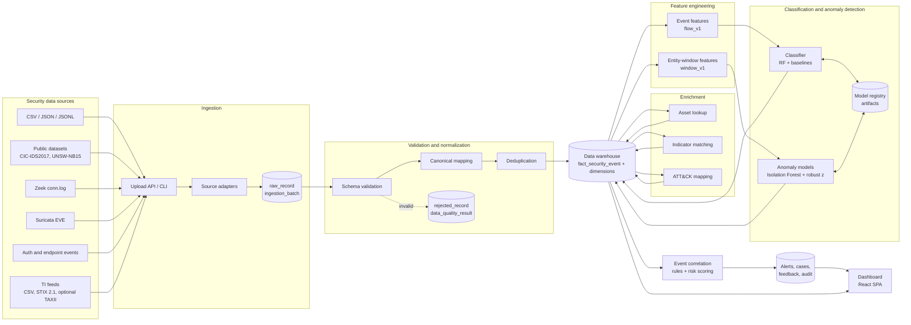
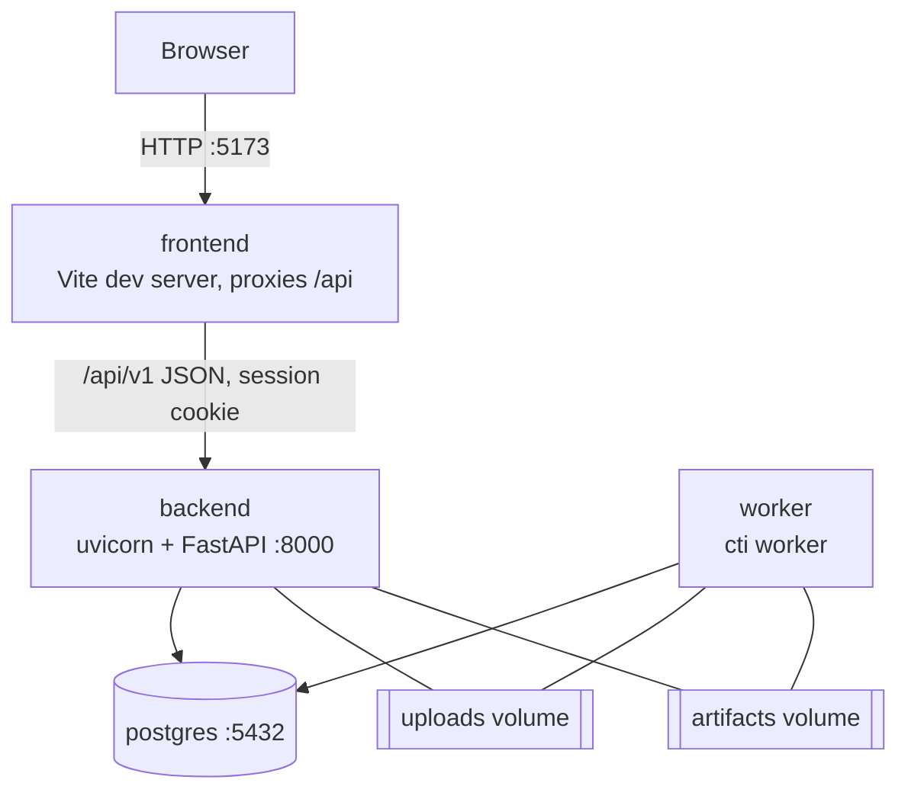

# Architecture

CTI Warehouse is a **modular monolith**: one backend codebase deployed as two processes (API server and background worker) that share a PostgreSQL database, plus a single-page React dashboard. Stack details: [TECH_STACK.md](TECH_STACK.md).

## 1. End-to-end pipeline



Every arrow into `DW` writes **new rows** (events, predictions, matches, scores); no stage overwrites the output of an earlier stage. Diagram conventions: [docs/diagrams/README.md](docs/diagrams/README.md).

The diagram shows **logical data flow**, not build order. Stages map to [roadmap](IMPLEMENTATION_ROADMAP.md) phases as follows (enrichment is drawn before ML because it runs on stored events, but indicator matching and ATT&CK are built after ML; each enrichment job can run at any time on stored events):

| Stage | Built in |
|---|---|
| Ingestion, validation, normalisation, warehouse, data quality, asset lookup | Phase 2 |
| Event feature engineering, classification, model registry | Phase 3 |
| Entity-window features, anomaly detection | Phase 4 |
| Indicator matching, ATT&CK mapping, correlation, alerts and cases | Phase 5 |
| Dashboard (full) | Phase 6 (shell in Phase 1) |
| Incremental processing, drift, temporal pattern mining | Phase 8 |

## 2. Deployment topology (MVP)



- `backend` and `worker` run the **same image** with different commands.
- Serving a production build of the frontend (static files behind a web server/reverse proxy) is an **open decision** ([docs/decisions/README.md](docs/decisions/README.md#open-decisions)); the MVP targets local use with the Vite dev server.
- `redis` is **not** part of the MVP. It is listed as optional in [TECH_STACK.md](TECH_STACK.md#5-optional-processing) and requires an ADR.

## 3. Component responsibilities

| Component | Package | Responsibility | Spec |
|---|---|---|---|
| API | `app/api/v1/` | HTTP routing, request/response schemas, auth dependencies, pagination. No business logic, no SQL. | [API_SPECIFICATION.md](API_SPECIFICATION.md) |
| Services | `app/services/` | Use-case orchestration, transactions, audit logging, job enqueueing. | — |
| Repositories | `app/repositories/` | All SQLAlchemy queries. Return ORM objects or typed rows. | [DATABASE_DESIGN.md](DATABASE_DESIGN.md) |
| Ingestion | `app/ingestion/` | Adapters (parse → canonical dicts), validation, normalisation, fingerprinting. Pure functions where possible. | [DATA_INGESTION.md](DATA_INGESTION.md) |
| Enrichment | `app/enrichment/` | Asset resolution, indicator matching, ATT&CK mapping. | [THREAT_INTELLIGENCE.md](THREAT_INTELLIGENCE.md) |
| Threat intel | `app/ti/` | Feed import, STIX parsing, indicator normalisation and lifecycle. | [THREAT_INTELLIGENCE.md](THREAT_INTELLIGENCE.md) |
| ML | `app/ml/` | Feature builders, training, evaluation, inference, artifact persistence, registry logic. Operates on DataFrames; DB I/O via repositories. | [ML_CLASSIFICATION.md](ML_CLASSIFICATION.md), [ANOMALY_DETECTION.md](ANOMALY_DETECTION.md) |
| Correlation | `app/correlation/` | Rule loading/evaluation, alert dedup, risk scoring. | [ATTACK_CORRELATION.md](ATTACK_CORRELATION.md) |
| Jobs | `app/jobs/` | PostgreSQL-backed job queue, handlers, worker loop. | §7 |
| Core | `app/core/` | Settings, logging, DB session, security helpers, error types. | [DEVELOPMENT_RULES.md](DEVELOPMENT_RULES.md) |
| CLI | `app/cli.py` (`cti` entry point) | Operator commands that call services directly (ingest, train, seed, create-admin, worker). | [DEPLOYMENT_GUIDE.md](DEPLOYMENT_GUIDE.md) |
| Frontend | `frontend/src/` | Pages, components, API client, query hooks. | [FRONTEND_SPECIFICATION.md](FRONTEND_SPECIFICATION.md) |

## 4. Repository layout (target)

```text
backend/
  pyproject.toml, uv.lock, alembic.ini, Dockerfile
  migrations/                 Alembic env + versions/
  app/
    main.py                   FastAPI app factory
    cli.py                    `cti` command-line entry point
    core/                     config, logging, db, security, errors
    api/v1/                   one router module per endpoint group
    schemas/                  Pydantic request/response models
    models/                   SQLAlchemy ORM models
    repositories/
    services/
    ingestion/adapters/       one module per adapter
    enrichment/
    ti/
    ml/features/ ml/classification/ ml/anomaly/ ml/registry.py
    correlation/
    jobs/
    devtools/                 synthetic data generator (dev/test only)
  tests/unit/ tests/integration/ tests/e2e/ tests/dataset/ tests/fixtures/
frontend/
  package.json, package-lock.json, vite.config.ts, Dockerfile
  src/api/ src/components/ src/features/<area>/ src/pages/ src/routes.tsx src/test/
config/
  label_mappings/*.toml       dataset label → canonical category
  feature_sets/*.toml
  correlation_rules/*.toml    rules + risk_weights.toml
  attack_mappings/*.toml      category → ATT&CK technique mappings
  datasets/*.toml             dataset column specs / field paths
  ml/*.toml                   training configs
docker/postgres/init/          creates the test database
data/                          git-ignored except data/samples/
  samples/                    small synthetic fixtures (committed)
  external/                   user-downloaded public datasets
artifacts/                     git-ignored model artifacts
docs/diagrams/ docs/decisions/
docker-compose.yml  .env.example
```

## 5. Layering and module boundaries

```text
api  ──▶  services  ──▶  repositories  ──▶  models (ORM)
                    └─▶  ingestion | enrichment | ti | ml | correlation  (domain modules)
jobs ──▶  services
cli  ──▶  services
```

Rules (enforced in review; see [DEVELOPMENT_RULES.md](DEVELOPMENT_RULES.md#3-architecture-boundaries)):

1. `api` may import `services`, `schemas`, `core`. Never `repositories` or ORM sessions directly.
2. Domain modules never import `api`, `services`, or FastAPI.
3. ML training/inference code accepts DataFrames/arrays and configs; it does not open DB sessions.
4. Only `services` define transaction boundaries (`session.begin()`).
5. Cross-module communication goes through service functions, not shared mutable state.
6. The frontend never constructs SQL-like queries; it calls documented endpoints with documented filters.

## 6. Data flow and interfaces

| Stage | Input | Output (tables) | Interface |
|---|---|---|---|
| Upload | multipart file + `source_id` + `adapter` | file in upload dir, `ingestion_batch` (status `pending`), `job` | `POST /api/v1/ingestion/uploads`, `cti ingest` |
| Parse | file stream | `raw_record` rows | `Adapter.iter_records(stream) -> Iterator[RawRecord]` |
| Validate/normalise | `RawRecord` | `CanonicalEvent` or `RejectedRecord` | `Adapter.to_canonical(raw) -> CanonicalEvent` + validators |
| Deduplicate/load | canonical events | `fact_security_event`, `event_ground_truth`, `rejected_record` | `INSERT ... ON CONFLICT DO NOTHING` on fingerprint |
| Data quality | batch | `data_quality_result` | `run_quality_checks(batch_id)` |
| Enrich | events | `indicator_match`; asset keys | matching service / job |
| Features | events | in-memory DataFrames (not persisted except anomaly feature snapshots) | `build_features(events_df, feature_set)` |
| Classify | features + active model | `classification_result` | scoring job |
| Anomaly | entity windows + model | `anomaly_result` | scoring job |
| Correlate | events, results, matches | `alert`, `alert_evidence` | correlation job |
| Investigate | alerts | `incident_case`, `case_timeline_entry`, `analyst_feedback` | API |

## 7. Background jobs

- Long-running work (ingestion of a batch, training, scoring, matching, correlation, feed sync) runs as a **job**.
- MVP queue: a `job` table in PostgreSQL. The worker claims jobs with `SELECT ... FOR UPDATE SKIP LOCKED`, sets `running`, executes the handler, and records `succeeded`/`failed` with error details and progress.
- API endpoints that start work return **202 Accepted** with a `job_id`; clients poll `GET /api/v1/jobs/{job_id}`.
- Jobs are idempotent or guarded: re-running an ingestion job for a completed batch is a no-op.
- A job stuck in `running` past its heartbeat timeout is marked `failed` with reason `worker_timeout`, never silently retried for training jobs.
- Celery/Redis is an **optional future** replacement behind the same `enqueue(job_type, params)` interface.

## 8. Error handling

| Layer | Behaviour |
|---|---|
| Adapter / record level | Record-level errors become `rejected_record` rows with `error_code`; the batch continues. |
| Batch level | Fatal errors (unreadable file, wrong adapter, encoding failure, exceeded rejection threshold) set batch `failed` with `error_summary`. Already-written raw records are kept for diagnosis. |
| Job level | Exceptions are caught by the worker, logged with `job_id`, stored in `job.error`, status `failed`. |
| Service level | Raise typed domain errors (`NotFound`, `Conflict`, `ValidationFailed`, `PermissionDenied`). |
| API level | Domain errors map to RFC 9457 problem responses ([API_SPECIFICATION.md](API_SPECIFICATION.md#4-errors)). Unexpected errors → 500 with `request_id`, no stack trace in the response. |
| Frontend | Error states show the problem `title`/`detail` and `request_id`; never substitute fake data. |

## 9. Batch and incremental processing

- **Batch (MVP):** each ingestion batch is processed end-to-end; scoring, matching, and correlation jobs run on a selected scope (batch IDs or time range).
- **Incremental (designed now, completed in Phase 8):** each downstream job records a **watermark** (`max(ingested_at)` or last `event_id` processed) in `processing_watermark`. Subsequent runs process only events beyond the watermark. Correlation re-evaluates a trailing look-back window equal to the largest rule window to catch late-arriving evidence.
- Late or out-of-order events are accepted; `event_time` and `ingested_at` are stored separately.

## 10. Scalability path (future — only with a demonstrated requirement)

1. Tune indexes and monthly partitioning of large facts ([DATABASE_DESIGN.md](DATABASE_DESIGN.md#7-partitioning-strategy)).
2. Run multiple worker processes (the `SKIP LOCKED` queue supports this).
3. Add materialised aggregate tables refreshed by jobs for dashboard queries.
4. Replace the job table with Celery + Redis (ADR required).
5. Consider columnar storage or an analytical engine only after measured PostgreSQL limits (ADR required).

Microservices, message buses, and cluster schedulers are explicitly out of scope until an ADR shows a requirement that the steps above cannot meet.
