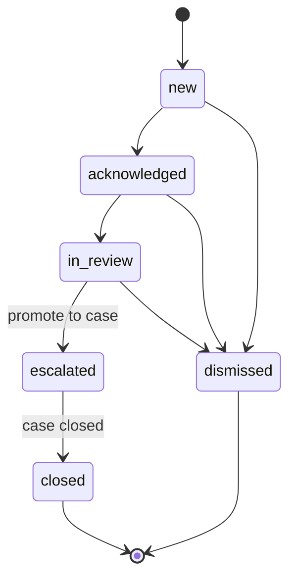

# Attack Correlation, Alerts, and Investigations

How evidence from events, classifications, anomalies, and indicator matches is combined into **alerts** (hypotheses) and how analysts turn them into **cases** (investigations). Tables: [DATABASE_DESIGN.md](DATABASE_DESIGN.md#37-correlation-alerts-cases-feedback). Code: `backend/app/correlation/`.

## 1. Principles

- **Alerts are hypotheses.** An alert says "these pieces of evidence, under rule R, suggest something worth reviewing". Only a case closed with disposition `confirmed_incident` represents a confirmed incident. API fields and UI labels keep this distinction.
- **Transparent.** Every alert lists its rule (exact version), every piece of evidence, and the full risk-score breakdown.
- **Deterministic and idempotent.** Re-running correlation on the same data produces the same alerts without duplicating evidence.
- **Configurable, not hard-coded.** Rules are versioned data validated against a schema; code implements the operators.

## 2. Evidence types

| Evidence type | Source table | Typical entity |
|---|---|---|
| `event` | `fact_security_event` | `src_ip`, `dst_ip`, `account`, `host` |
| `classification_result` | `classification_result` (active model only by default) | event's `src_ip`/`dst_ip` |
| `anomaly_result` | `anomaly_result` with `is_flagged = true` | window's entity |
| `indicator_match` | `indicator_match` with state `active` (default) | the event's counterpart entity |

Asset importance comes from `dim_asset.criticality` of the involved entity (`unknown` if no inventory).

## 3. Rule definition

Rules live in `config/correlation_rules/*.toml` (seeded into `correlation_rule` by `cti seed-reference`) and can be created/edited via API (admin). Edits create a new **version**; alerts reference the exact version.

```toml
[[rule]]
key = "bruteforce_then_success"
version = 1
name = "Repeated authentication failures followed by a success"
description = "Many failed logins for one account then a success within the window."
entity_type = "account"
group_by = ["user_name_normalized"]
window = "15m"
base_severity = "high"          # low | medium | high | critical
enabled = true

[[rule.steps]]
id = "failures"
evidence = "event"
where = { event_type = "auth", auth_result = "failure" }
min_count = 10

[[rule.steps]]
id = "success"
evidence = "event"
where = { event_type = "auth", auth_result = "success" }
min_count = 1
after = "failures"              # ordering constraint within the window
```

DSL constraints (validated by a Pydantic schema; invalid rules are rejected with 422):

- `evidence` ∈ {`event`, `classification_result`, `anomaly_result`, `indicator_match`}.
- `where` keys must be on a per-evidence-type **allowlist** of canonical fields (e.g., `event_type`, `auth_result`, `dst_port`, `signature_id`, `predicted_category`, `min_predicted_score`, `exclude_benign`, `min_score_percentile`, `min_confidence`, `indicator_state`). Operators: equality, `in` (list), `min_*`/`max_*` thresholds. No free-form SQL, expressions, or regex. An `event` step may also set `same` (`signature_id`, `dst_port`, or `dst_ip`) to require that `min_count` items share one value of that field.
- `window` ∈ {`5m`, `15m`, `1h`, `2h`, `6h`, `24h`}; `min_count` ≥ 1; `after` references an earlier step.
- Rules compile to parameterised SQLAlchemy queries.

## 4. Default rules (MVP)

| Key | Entity | Logic (all within `window`) | Window | Base severity |
|---|---|---|---|---|
| `ti_match_active` | `host` / IP counterpart | ≥ 1 `active` indicator match with confidence ≥ 50 involving the entity. | 1h | high |
| `bruteforce_then_success` | `account` | ≥ 10 auth failures followed by ≥ 1 success. | 15m | high |
| `recon_then_attack` | `src_ip` | ≥ 1 event classified `RECONNAISSANCE` (score ≥ 0.6), followed by ≥ 1 event from the same `src_ip` classified as any other non-benign category (score ≥ 0.6). | 2h | medium |
| `anomaly_with_malicious_classification` | `src_ip` / `host` | A flagged anomaly window for the entity overlapping ≥ 1 event of that entity with a non-benign classification (score ≥ 0.6). | 1h | medium |
| `repeated_ids_signature` | `src_ip` | ≥ 5 `ids_alert` events with the same `signature_id` from the same `src_ip`. | 1h | low |

Thresholds are starting points, to be tuned with analyst feedback; tuning creates a new rule version.

## 5. Alert deduplication

- `dedup_key = "<rule_key>:<entity_type>:" + sha256(entity_value)[:16]`.
- If an **open** alert (`new`, `acknowledged`, `in_review`) exists with the same `dedup_key`, new evidence is appended to it (`alert_evidence` PK prevents duplicates), `last_event_time`/`evidence_count` updated, risk recomputed, and an `updated` timeline/audit entry written. A partial unique index enforces one open alert per key.
- If the previous alert is `dismissed`, `escalated`, or `closed`, a **new** alert is created and linked (`related_alert_id` in `risk_breakdown.context`), so analyst decisions are not silently reopened.
- Stored evidence per alert is capped at 10,000 rows (`MAX_EVIDENCE_PER_ALERT` in `app/services/correlation.py`; not configurable in the current build). Beyond the cap, `evidence_count` still counts every item, the first 10,000 stored rows are kept, and `risk_breakdown.evidence_cap.capped` records that the cap was reached.

## 6. Risk scoring

A transparent, additive 0–100 score. **Not a probability.** Version `risk_v1`, weights in `config/correlation_rules/risk_weights.toml`.

| Component | Max | Formula (over the alert's evidence) |
|---|---|---|
| `classification` | 30 | 30 × max(`severity_weight(predicted_category)` × `predicted_score`) over non-benign classifications |
| `anomaly` | 20 | 20 × max(`score_percentile` / 100) over flagged anomaly windows |
| `threat_intel` | 30 | 30 × max(`confidence`/100 × `reliability_weight(feed)`) over active matches |
| `repetition` | 10 | 10 × min(1, log10(`evidence_count`) / 3) |
| `rule_severity` | 10 | 10 × {low 0.25, medium 0.5, high 0.75, critical 1.0} |

`base = sum(components)`; `asset_multiplier` = {unknown 1.0, low 0.8, medium 1.0, high 1.2, critical 1.4} using the most critical involved asset; `risk_score = min(100, round(base × asset_multiplier))`.

`risk_breakdown` stores, per component, the value, weight, and the **evidence reference** that produced the maximum, plus `risk_model_version`, the multiplier, and the asset used. The UI renders this as a table so an analyst can see exactly why a score is 68 and not 40.

Severity labels for display: 0–24 `low`, 25–49 `medium`, 50–74 `high`, 75–100 `critical`.

## 7. Incident timelines and evidence retention

- **Alert timeline:** evidence sorted by `event_time` (or window start), each item showing its type, category (fact / model output / match), and link.
- **Case timeline** (`case_timeline_entry`, append-only): linked alerts' evidence (auto-added when an alert is linked), analyst notes, status changes, disposition. Ordered by `entry_time`.
- Evidence rows and the events they reference are retained while any linked case is open, and at least as long as the alert exists ([retention](DATABASE_DESIGN.md#9-retention)).
- Notes are plain text; no HTML or Markdown rendering of user- or log-supplied content.

## 8. Analyst review workflow



1. **Triage** the alert queue (sorted by risk, filtered by status/rule/entity).
2. **Review** evidence and breakdown; pivot to events, entity history, anomaly detail, indicator detail.
3. **Decide:** dismiss with a reason (creates `analyst_feedback` with verdict) or escalate to a new/existing case.
4. **Investigate** in the case: add notes, link more alerts, assign owner.
5. **Close** the case with a disposition: `confirmed_incident`, `false_positive`, `benign_true_positive`, `inconclusive`.
6. **Feedback** on individual classifications/anomalies/matches is recorded as `analyst_feedback` and summarised per rule/model on the Models and Settings pages (e.g., dismissal rate per rule).

Every transition writes a timeline entry (cases) and an `audit_log` row.

## 9. Correlation execution

- `POST /api/v1/correlation/runs` / `cti correlate --from <ts> --to <ts>` enqueue a job over an event-time range. Each rule evaluates the range plus a look-back equal to its window so sequences spanning the boundary are found.
- Rules only use evidence that already exists (classification/anomaly scoring and matching should be run first; the run report lists which evidence types were available for the range).
- Phase 8: incremental runs driven by `processing_watermark`.

## 10. Future temporal pattern mining (Phase 8)

- Build per-entity event sequences (tokens such as `auth:failure`, `class:RECONNAISSANCE`, `ids:<signature_id>`, `anomaly:flagged`) segmented by inactivity gaps.
- Mine frequent sequential patterns / episodes with minimum support and maximum gap constraints (algorithm choice — e.g., PrefixSpan-style — recorded in an ADR; in-house implementation preferred over a new dependency).
- Contrast patterns between labelled-malicious and benign sequences where labels exist.
- Output: **candidate rules** with support/confidence statistics for human review. Mined patterns are never enabled automatically.

**Status (Phase 8):** implemented as `cti mine-patterns` and `POST/GET /correlation/pattern-runs` ([ADR-0010](docs/decisions/0010-in-house-sequential-pattern-mining.md)). Tokens: `auth:<result>`, `ids:<signature_id>`, `class:<category>` (active classifier, non-benign, score ≥ 0.6), `anomaly:flagged` (active models). Each candidate carries support, labelled-malicious support, a malicious ratio, example entities, and a **disabled** draft rule whose `min_count` values are the smallest observed run lengths. On the seed-42 synthetic scenario (`min_support = 1`) the planted brute force is recovered as `auth:failure ×25 → auth:success` for `svc-backup`. With one planted occurrence per pattern, support is 1; real deployments should use higher support.
