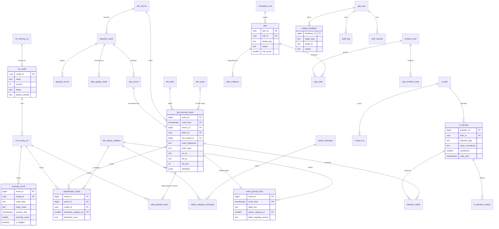

# Database Design — PostgreSQL Warehouse

Field-level definitions live in [DATA_DICTIONARY.md](DATA_DICTIONARY.md); this file defines tables, keys, relationships, and data-management policy. All schema changes go through Alembic ([§11](#11-migration-rules)).

## 1. Modelling approach

- **Layered storage in one PostgreSQL database** (single `public` schema in the MVP; table prefixes denote layers):

| Layer | Prefix / tables | Mutability |
|---|---|---|
| Raw (landing) | `ingestion_batch`, `raw_record`, `rejected_record` | Append-only (status columns on batch only). |
| Warehouse — dimensions | `dim_*` | Reference data; `dim_asset` is SCD Type 2. |
| Warehouse — facts | `fact_security_event`, `event_ground_truth` | Append-only; never updated after load except lineage-safe enrichment keys. |
| Derived / model outputs | `classification_result`, `web_payload_result`, `anomaly_result`, `indicator_match` | Append-only per run. |
| Threat intel & ATT&CK | `ti_*`, `attack_*` | Versioned updates. |
| ML registry | `ml_model`, `ml_training_run`, `ml_scoring_run` | Status transitions only. |
| Investigation | `correlation_rule`, `alert`, `alert_evidence`, `incident_case`, `case_alert`, `case_timeline_entry`, `analyst_feedback` | Status transitions; feedback and timeline append-only. |
| Operations | `app_user`, `auth_session`, `audit_log`, `job`, `processing_watermark`, `data_quality_result` | `audit_log` append-only. |

- **Dimensional model (star schema):** `fact_security_event` is the central fact at the grain of **one normalised security event** (one flow, one IDS alert, one authentication attempt, one endpoint event). It references `dim_date`, `dim_source`, `dim_asset` (twice: source and destination), and via `event_ground_truth`/`classification_result` the `dim_attack_category` dimension.
- **Facts vs. predictions vs. conclusions** are stored in separate tables: observed data in `fact_security_event`; dataset labels in `event_ground_truth`; model outputs in `classification_result`/`web_payload_result`/`anomaly_result`; hypotheses in `alert`; analyst conclusions in `analyst_feedback` and `incident_case.disposition`.

## 2. Conventions

- Table and column names: `snake_case`, singular table names.
- High-volume tables use `bigint GENERATED ALWAYS AS IDENTITY` keys; user-facing workflow entities (batches, jobs, models, runs, alerts, cases) use `uuid` keys (generated in Python with `uuid4`).
- **Timestamps:** always `timestamptz`, stored in UTC. Source timestamps without a timezone are interpreted using the source's configured `default_timezone` (default `UTC`) and the assumption is recorded in `ingestion_batch.timezone_assumption`. Never store naive timestamps.
- Every table has `created_at timestamptz NOT NULL DEFAULT now()`; mutable tables also have `updated_at`.
- Enumerations are `text` columns with `CHECK` constraints (easier to migrate than PostgreSQL enums).
- IP addresses use `inet`; hashes use `text` lowercase hex with `CHECK` on length.
- Free-form source-specific fields go to `attributes jsonb`, never into new ad-hoc columns without a migration and dictionary entry.

## 3. Logical entities

### 3.1 Raw ingestion

**`ingestion_batch`** — one uploaded/imported file.

| Column | Type | Notes |
|---|---|---|
| `batch_id` | uuid PK | |
| `source_id` | bigint FK → `dim_source` | |
| `adapter` / `adapter_version` | text | e.g., `cicids2017` / `1` |
| `original_filename` | text | Display only; never used as a path. |
| `stored_path` | text | Server-generated path under upload dir. |
| `file_sha256` | text | Idempotency key component. |
| `file_size_bytes` | bigint | |
| `status` | text | `pending`, `processing`, `completed`, `completed_with_errors`, `failed`, `duplicate` ([lifecycle](DATA_INGESTION.md#8-batch-status-and-retries)) |
| `last_committed_record` | bigint | Resume point after a failed chunk. |
| `records_total`, `records_loaded`, `records_rejected`, `records_duplicate` | bigint | Counters (all reconcile: total = loaded + rejected + duplicate). |
| `timezone_assumption` | text | |
| `label_mapping_version` | text NULL | For labelled datasets. |
| `error_summary` | jsonb NULL | Fatal error or top rejection codes. |
| `created_by` | uuid FK → `app_user` NULL | NULL for CLI with `actor_type=cli` in audit. |
| `started_at`, `finished_at` | timestamptz | |

Unique: `(source_id, file_sha256, adapter, adapter_version)` — re-uploading the same file is detected ([DATA_INGESTION.md](DATA_INGESTION.md#6-deduplication-and-idempotency)).

**`raw_record`** — one record exactly as received.

| Column | Type | Notes |
|---|---|---|
| `raw_record_id` | bigint PK | |
| `batch_id` | uuid FK | |
| `record_number` | bigint | 1-based line/record number in the file. |
| `raw_payload` | jsonb NULL | Parsed source record (CSV row as object, JSON object). |
| `raw_text` | text NULL | Original line when it could not be parsed as structured data (truncated to 64 KiB, flag set). |
| `raw_truncated` | boolean | |
| `raw_nul_escaped` | boolean | NUL bytes / unpaired surrogates were escaped for storage. |
| `record_sha256` | text | Hash of the original bytes. |
| `received_at` | timestamptz | |

Unique: `(batch_id, record_number)`.

**`rejected_record`** — validation failures.

`rejected_record_id` PK, `batch_id` FK, `raw_record_id` FK, `record_number`, `error_code` (from the catalogue in [DATA_INGESTION.md](DATA_INGESTION.md#7-invalid-record-handling)), `field_name` NULL, `error_detail` text (sanitised, ≤ 1 KiB).

### 3.2 Dimensions

**`dim_date`** — `date_key int PK` (YYYYMMDD), `calendar_date date UNIQUE`, `year`, `quarter`, `month`, `day_of_month`, `iso_week`, `day_of_week` (1=Mon), `is_weekend`. Pre-populated for 2000-01-01 → 2040-12-31 by migration. Hour-of-day is stored on the fact (`event_hour`) rather than a separate time dimension.

**`dim_source`** — `source_id bigint PK`, `source_key text UNIQUE` (e.g., `cicids2017-lab`), `name`, `source_type` (`dataset`, `network_sensor`, `ids`, `auth`, `endpoint`, `ti_feed`, `other`), `default_adapter`, `default_timezone`, `reliability` (`A`–`F`, see [THREAT_INTELLIGENCE.md](THREAT_INTELLIGENCE.md#3-source-reliability-and-confidence)), `description`, `is_active`. SCD Type 1 (changes overwrite, audit log records the old value).

**`dim_asset`** — SCD Type 2. `asset_key bigint PK` (surrogate), `asset_id text` (natural key), `hostname`, `ip_address inet NULL`, `criticality` (`low`, `medium`, `high`, `critical`, `unknown`), `owner`, `environment`, `valid_from`, `valid_to` NULL, `is_current`. Partial unique index on `(asset_id) WHERE is_current`. Populated from an optional asset inventory CSV ([DATA_INGESTION.md](DATA_INGESTION.md#4-source-adapters)); if absent, events have NULL asset keys and correlation uses criticality `unknown`.

**`dim_attack_category`** — canonical attack taxonomy. `attack_category_id smallint PK`, `code text UNIQUE`, `name`, `description`, `is_benign boolean`, `severity_weight numeric(3,2)` (0–1, used by [risk scoring](ATTACK_CORRELATION.md#6-risk-scoring)). Seed values: `BENIGN`, `DOS`, `DDOS`, `RECONNAISSANCE`, `BRUTE_FORCE`, `WEB_ATTACK`, `BOTNET`, `INFILTRATION`, `EXPLOIT`, `BACKDOOR`, `SHELLCODE`, `WORM`, `FUZZING`, `ANALYSIS`, `GENERIC`, `OTHER_MALICIOUS`. Rationale and dataset mappings: [ML_CLASSIFICATION.md](ML_CLASSIFICATION.md#3-label-mapping).

**`attack_technique`** — imported MITRE ATT&CK techniques: `technique_id text PK` (e.g., `T1110`, `T1110.001`), `stix_id`, `name`, `tactics text[]`, `is_subtechnique`, `parent_technique_id` NULL, `attack_version text`, `deprecated boolean`, `revoked boolean`, `url`.

**`attack_category_technique`** — mapping category → technique: PK `(attack_category_id, technique_id)`, `mapping_confidence` (`low`, `medium`, `high`), `rationale text NOT NULL`, `mapping_version`.

### 3.3 Security events and ground truth

**`fact_security_event`** — partitioned by month on `event_time` ([§7](#7-partitioning-strategy)).

Key columns (full list with semantics in [DATA_DICTIONARY.md](DATA_DICTIONARY.md#3-security-event-fields)):

- Keys/lineage: `event_id bigint` + `event_time timestamptz` (composite PK — partition key must be in the PK), `source_id`, `batch_id`, `raw_record_id`, `source_event_id`, `event_fingerprint`, `adapter_version`, `normalizer_version`, `ingested_at`.
- Time: `event_time`, `event_end_time`, `time_quality` (`exact`, `second`, `assumed`), `date_key` FK → `dim_date`, `event_hour smallint`.
- Classification of the record type: `event_type`.
- Network: `src_ip`, `src_port`, `dst_ip`, `dst_port`, `protocol`, `ip_proto`, `app_protocol`, `direction`, `conn_state`.
- Flow metrics: `duration_s`, `bytes_out`, `bytes_in`, `packets_out`, `packets_in`.
- Authentication: `user_name`, `user_name_normalized`, `auth_result`, `auth_method`, `service`.
- Endpoint: `host_name`, `process_name`, `process_command_line`, `parent_process_name`, `file_path`, `file_sha256`.
- Application: `dns_query`, `http_host`, `url`.
- IDS: `signature_id`, `signature`, `alert_category`, `source_severity`.
- Enrichment keys: `src_asset_key`, `dst_asset_key` (FK → `dim_asset`, NULL allowed).
- `attributes jsonb` — source-specific fields (e.g., CICFlowMeter features).

Unique: `(source_id, event_fingerprint, event_time)`.

**`event_ground_truth`** — dataset-provided labels, **immutable after load**.

PK `(event_id, event_time)` FK → `fact_security_event`; `label_raw text NOT NULL`, `attack_category_id` FK NULL (NULL when unmapped), `is_attack boolean NULL`, `mapping_status` (`mapped`, `unmapped`, `ambiguous`), `label_mapping_version`, `label_origin` = `dataset` (CHECK). Analyst conclusions never go here; they go to `analyst_feedback`.

### 3.4 Threat intelligence and ATT&CK

**`ti_feed`** — `feed_id uuid PK`, `feed_key UNIQUE`, `name`, `feed_type` (`manual`, `csv_file`, `stix_file`, `taxii`), `url` NULL, `collection_id` NULL, `reliability` (`A`–`F`), `default_confidence smallint`, `default_ttl_days`, `enabled`, `poll_interval_minutes` NULL, `credentials_ref` NULL (name of an env var, never the secret), `last_success_at`, `last_error`, `last_error_at`.

**`ti_feed_run`** — `feed_run_id uuid PK`, `feed_id`, `job_id`, `status`, `started_at`, `finished_at`, `indicators_received/created/updated/rejected`, `error`.

**`ti_indicator`** — `indicator_id bigint PK`, `feed_id` FK, `indicator_type` (`ipv4`, `ipv6`, `domain`, `url`, `sha256`, `sha1`, `md5`, `email`), `value_raw`, `value_normalized`, `confidence smallint` (0–100), `severity` NULL, `tlp` NULL, `description`, `stix_id` NULL, `first_seen`, `last_seen`, `valid_from`, `valid_until` NULL, `revoked boolean`, `technique_ids text[]`, `last_feed_run_id`. Unique `(feed_id, indicator_type, value_normalized)`.

**`ti_indicator_version`** — append-only snapshot written whenever an indicator's confidence, validity, or revocation changes: `indicator_id`, `version_no`, `snapshot jsonb`, `changed_at`, `feed_run_id`.

**`indicator_match`** — `match_id bigint PK`, `event_id`, `event_time` (FK → event), `indicator_id` FK, `matched_field` (e.g., `dst_ip`), `matched_value`, `match_type` = `exact`, `indicator_confidence_at_match`, `indicator_state_at_match` (`active`, `expired`, `revoked`), `matcher_version`, `matched_at`, `job_id`. Unique `(event_id, event_time, indicator_id, matched_field)`.

### 3.5 ML registry and model outputs

**`ml_training_run`** — `run_id uuid PK`, `task` (`classification`, `anomaly`), `status` (`queued`, `running`, `succeeded`, `failed`), `config jsonb`, `random_seed`, `dataset_snapshot jsonb` (batch IDs, filters, row counts per class, snapshot hash), `feature_set_version`, `label_mapping_version` NULL, `split_strategy`, `metrics jsonb`, `baseline_metrics jsonb`, `confusion_matrix jsonb` NULL, `environment jsonb` (Python/library versions, git commit), `job_id`, `triggered_by`, `started_at`, `finished_at`, `error`.

**`ml_model`** — `model_id uuid PK`, `name` (e.g., `attack_classifier`, `host_window_iforest`), `version int`, `task`, `algorithm`, `status` (`candidate`, `active`, `archived`, `rejected`), `training_run_id` FK, `artifact_path`, `artifact_sha256`, `feature_set_version`, `label_mapping_version`, `class_labels text[]` NULL, `threshold jsonb` NULL (anomaly), `promoted_at`, `promoted_by`. Unique `(name, version)`; partial unique index `(name) WHERE status = 'active'` (one active model per name).

**`ml_scoring_run`** — `scoring_run_id uuid PK`, `model_id`, `scope jsonb` (batch IDs / time range), `status`, `rows_scored`, `job_id`, timestamps, `error`.

**`classification_result`** — `result_id bigint PK`, `event_id`, `event_time` (FK → event), `model_id` FK, `scoring_run_id` FK, `predicted_category_id` FK, `predicted_score real` (classifier vote fraction for the predicted class; **not calibrated**), `class_scores jsonb`, `scored_at`. Unique `(event_id, event_time, model_id)`.

**`web_payload_result`** — predictions of the web payload model (`web_attack_classifier`, task `web_payload_classification`) for the decoded query parameters of `http` events: `result_id bigint PK`, `event_id`, `event_time` (FK → event, cascade), `model_id` FK, `scoring_run_id` FK, `param_index smallint` (position in the event's `attributes.query_params`), `param_name`, `predicted_class` (`BENIGN`, `SQLI`, `XSS`, `PATH_TRAVERSAL`, `CMDI` — the model's own classes, not `dim_attack_category` codes), `is_attack_like boolean`, `score double precision` and `score_kind` (logistic-regression probability or SVM decision score; **not calibrated**), `class_scores jsonb`, `truncated boolean`, `scored_at`. Unique `(event_id, event_time, model_id, param_index)`, so re-scoring is idempotent. The parameter **value is not copied**: it is read from the event (observed fact). Added by migration `4e1ff4ad3cf5`.

**`anomaly_result`** — `result_id bigint PK`, `model_id` FK, `scoring_run_id` FK, `method` (`isolation_forest`, `robust_zscore`), `entity_type` (`host`, `account`, `src_ip`), `entity_value`, `window_start`, `window_end`, `window_size` (interval), `anomaly_score double precision`, `score_percentile real`, `threshold double precision`, `is_flagged boolean`, `feature_snapshot jsonb`, `baseline_snapshot jsonb` NULL, `top_deviations jsonb`, `scored_at`. Unique `(model_id, entity_type, entity_value, window_start)`.

### 3.6 Operations and security

- **`app_user`** — `user_id uuid PK`, `username UNIQUE` (stored lowercase, CHECK), `password_hash` (argon2id), `role` (`viewer`, `analyst`, `admin`), `is_active`, `failed_login_count`, `locked_until`, `last_login_at`.
- **`auth_session`** — `session_id uuid PK`, `user_id`, `token_hash` (HMAC-SHA-256 of the opaque token, keyed with `CTI_SECRET_KEY`), `csrf_token_hash`, `created_at`, `expires_at`, `last_seen_at` (idle timeout; refreshed at most once a minute), `revoked_at`, `ip_address`, `user_agent` (truncated).
- **`audit_log`** — append-only: `audit_id bigint PK`, `occurred_at`, `actor_type` (`user`, `system`, `cli`), `actor_user_id` NULL, `actor_label` (username snapshot or `cli`/`system`), `action` (e.g., `ingestion.upload`, `model.promote`), `target_type`, `target_id`, `outcome` (`success`, `denied`, `error`), `request_id`, `ip_address`, `details jsonb` (no secrets, no raw payloads). The application DB role has no `UPDATE`/`DELETE` privilege on this table in deployed environments; retention deletes only through `prune_audit_log(cutoff)` (`SECURITY DEFINER`, refuses cutoffs newer than 364 days) ([SECURITY_REQUIREMENTS.md](SECURITY_REQUIREMENTS.md#7-audit-logging)).
- **`job`** — `job_id uuid PK`, `job_type`, `status` (`queued`, `running`, `succeeded`, `failed`, `cancelled`), `params jsonb`, `progress jsonb`, `result jsonb`, `error jsonb`, `attempts`, `max_attempts`, `run_after` (retry back-off), `heartbeat_at`, `cancel_requested` (cooperative cancel of running jobs), `created_by`, timestamps. Index `(status, run_after, created_at)` for claiming.
- **`processing_watermark`** — `consumer text PK` (e.g., `indicator_matching`), `last_ingested_at`, `last_event_id`, `updated_at` (Phase 8 incremental processing).
- **`data_quality_result`** — `dq_result_id PK`, `batch_id`, `check_name`, `status` (`pass`, `warn`, `fail`), `metric_value`, `threshold`, `details jsonb`, `checked_at`.

### 3.7 Correlation, alerts, cases, feedback

- **`correlation_rule`** — `rule_id uuid PK`, `rule_key`, `version int`, `name`, `description`, `enabled`, `definition jsonb` (validated rule DSL, [ATTACK_CORRELATION.md](ATTACK_CORRELATION.md#3-rule-definition)), `base_severity`, `created_by`. Unique `(rule_key, version)`; edits create a new version.
- **`alert`** — correlation hypothesis. `alert_id uuid PK`, `rule_id` FK (specific version), `dedup_key`, `status` (`new`, `acknowledged`, `in_review`, `escalated`, `dismissed`, `closed`), `title`, `primary_entity_type`, `primary_entity_value`, `risk_score smallint` (0–100), `risk_breakdown jsonb`, `first_event_time`, `last_event_time`, `evidence_count`, `assigned_to` NULL, `case_id` NULL FK. Partial unique index `(dedup_key) WHERE status IN ('new','acknowledged','in_review')`.
- **`alert_evidence`** — `alert_id`, `evidence_type` (`event`, `classification_result`, `anomaly_result`, `indicator_match`, `web_payload_result` — added by migration `7b2d4f9e1a63`), `evidence_ref bigint`, `event_time` NULL, `contribution jsonb`, `added_at`. PK `(alert_id, evidence_type, evidence_ref)`. Evidence rows are never deleted while the alert exists.
- **`incident_case`** — `case_id uuid PK`, `title`, `status` (`open`, `investigating`, `closed`), `disposition` NULL (`confirmed_incident`, `false_positive`, `benign_true_positive`, `inconclusive`), `severity`, `assigned_to`, `summary`, `opened_by`, `opened_at`, `closed_at`.
- **`case_alert`** — PK `(case_id, alert_id)`.
- **`case_timeline_entry`** — append-only: `entry_id`, `case_id`, `entry_time`, `entry_type` (`note`, `status_change`, `alert_linked`, `evidence`), `author_id`, `body` (plain text), `ref jsonb`.
- **`analyst_feedback`** — append-only: `feedback_id`, `target_type` (`event`, `classification_result`, `anomaly_result`, `indicator_match`, `alert`), `target_id`, `verdict` (`true_positive`, `false_positive`, `benign_unusual`, `needs_more_info`), `corrected_category_id` NULL, `comment`, `analyst_id`, `created_at`. The latest feedback per target is derived by query; earlier feedback is kept.

## 4. Entity-relationship diagram

`alert_evidence.evidence_ref` and `analyst_feedback.target_id` are **polymorphic references** (no FK); services validate that the referenced row exists before inserting.

## 5. Indexes

| Table | Index | Purpose |
|---|---|---|
| `fact_security_event` | `(event_time DESC)` (per partition) | Time-range queries. |
| | `(source_id, event_time)` | Source filters. |
| | `(src_ip, event_time)`, `(dst_ip, event_time)` | Entity pivots, correlation. |
| | `(dst_port, event_time)` | Port analytics. |
| | `(user_name, event_time) WHERE user_name IS NOT NULL` | Account baselines. |
| | `(host_name, event_time) WHERE host_name IS NOT NULL` | Host baselines. |
| | `(event_type, event_time)` | Type filters. |
| | `(batch_id)` | Batch drill-down, retention. |
| | `UNIQUE (source_id, event_fingerprint, event_time)` | Dedup. |
| `event_ground_truth` | `(attack_category_id)` | Training snapshots. |
| `classification_result` | `(model_id, predicted_category_id)`, `(event_id, event_time)` | Analytics, event detail. |
| `anomaly_result` | `(model_id, is_flagged, window_start)`, `(entity_type, entity_value, window_start)` | Explorer, correlation. |
| `ti_indicator` | `(indicator_type, value_normalized)` | Exact matching. |
| `indicator_match` | `(indicator_id)`, `(event_id, event_time)` | Pivots. |
| `alert` | `(status, risk_score DESC)`, `(primary_entity_type, primary_entity_value)` | Queue, entity pivot. |
| `audit_log` | `(occurred_at DESC)`, `(actor_user_id, occurred_at)`, `(target_type, target_id)` | Audit browsing. |
| `job` | `(status, created_at)` | Worker claim. |

Add indexes only with a query that needs them; verify with `EXPLAIN ANALYZE` on realistic volumes and record results in the PR description.

## 6. Idempotent ingestion

1. **File-level:** `(source_id, file_sha256, adapter, adapter_version)` unique on `ingestion_batch`. A repeat upload creates a batch with status `duplicate` referencing the original (no events loaded) — unless the user explicitly requests re-processing after an adapter version change, which yields a new batch whose events still dedup at record level.
2. **Record-level:** `event_fingerprint` = SHA-256 over the canonical, normalised identity fields defined per adapter ([DATA_INGESTION.md](DATA_INGESTION.md#6-deduplication-and-idempotency)). Insert with `ON CONFLICT (source_id, event_fingerprint, event_time) DO NOTHING`; conflicts increment `records_duplicate`.
3. **Derived results:** unique constraints on `(event, model)` for classifications, `(model, entity, window)` for anomalies, `(event, indicator, field)` for matches make re-running jobs safe.

## 7. Partitioning strategy

- `fact_security_event` is **range-partitioned by month** on `event_time` in the MVP. Partition names: `fact_security_event_yYYYYmMM`.
- Before loading a batch, the ingestion service calls `ensure_event_partitions(min_time, max_time)` (a SQL function created by migration) which creates missing monthly partitions. It is `SECURITY DEFINER` (owned by the migration role, fixed `search_path`, `EXECUTE` granted only to the application role) so a DML-only application role can still trigger partition creation; partitions are created only while no chunk of the same load is being written (DATA_INGESTION.md §8). Public datasets with historical timestamps (e.g., 2015, 2017) therefore get their own partitions.
- A `DEFAULT` partition exists as a safety net; a data-quality check fails if it contains rows.
- Other tables are not partitioned in the MVP. Candidates if volume requires (measured): `raw_record` (by `received_at`), `classification_result`, `indicator_match`.
- Foreign keys to `fact_security_event` reference the full PK `(event_id, event_time)`; referencing tables therefore carry `event_time`.

## 8. Historical preservation and lineage

- Raw → event lineage: `fact_security_event.raw_record_id` → `raw_record` → `ingestion_batch` (file hash, adapter version, uploader).
- Normalisation lineage: `adapter_version`, `normalizer_version` on every event; `label_mapping_version` on every ground-truth row.
- Model lineage: `classification_result.model_id` → `ml_model` → `ml_training_run` (snapshot, config, seed, environment).
- Indicator lineage: `indicator_match` stores indicator confidence/state **at match time**; `ti_indicator_version` keeps history.
- Alert lineage: `alert.rule_id` is the exact rule version; `alert_evidence` lists every contributing row; `risk_breakdown` stores the inputs and weights used.
- Corrections never overwrite: re-normalisation with a new adapter version produces a new batch; analyst corrections are new `analyst_feedback` rows.

## 9. Retention

Defaults (configurable via environment, enforced by `cti retention apply --dry-run|--execute`, admin only, audited):

| Data | Default retention | Note |
|---|---|---|
| Uploaded files on disk | 30 days after batch completes | Raw records remain in DB. |
| `raw_record` | Same as its events | Deleting raw while events remain breaks lineage — not allowed. |
| `fact_security_event` and dependants | Indefinite (dev); policy decided per deployment | Delete by dropping whole monthly partitions plus dependants. |
| `rejected_record` | 90 days | |
| `job` | 90 days for succeeded; failed kept 180 days | |
| `auth_session` | 7 days after expiry | |
| `audit_log` | ≥ 1 year; never deleted by application code paths other than the retention command | |
| Model artifacts | Keep all `active` and their predecessors; archived after 180 days may be removed if no results reference them | |

Retention never deletes ground truth, feedback, or alert evidence while a referencing case is open.

## 10. Transaction boundaries

| Operation | Transaction scope |
|---|---|
| Upload request | Insert `ingestion_batch` + `job` + audit row in one transaction; file written to disk before commit, removed on rollback. |
| Ingestion job | Chunked: each chunk (default 5,000 records) inserts raw records, events, ground truth, rejects, and counter updates atomically. Batch status updated in its own transaction at start/end. A failed chunk rolls back only that chunk; the batch ends `failed` with the last committed record number recorded so it can be resumed. |
| Training run | Model row + artifact registration in one transaction **after** the artifact file is written and hashed. Artifact files without a committed row are orphans cleaned by `cti artifacts gc`. |
| Scoring/matching | Chunked inserts; scoring run status updated at end. |
| Model promotion | Demote current active + promote candidate + audit row in one transaction (partial unique index guarantees one active). |
| Alert creation | Upsert alert by `dedup_key` + insert evidence + audit row atomically. |
| Case updates | Status change + timeline entry + audit row atomically. |

Long-running jobs must not hold one transaction for the whole run.

## 11. Migration rules

1. Every schema change is an Alembic revision in `backend/migrations/versions/`, named `YYYYMMDD_HHMM_<short_description>.py`.
2. Autogenerate is a starting point only; review and hand-edit (partitions, functions, partial indexes, CHECKs are not reliably autogenerated).
3. Migrations must run on an **empty database** and on the **previous head**; both are tested ([TESTING_STRATEGY.md](TESTING_STRATEGY.md#5-migration-tests)).
4. Provide `downgrade()`. If impossible (data-destructive), raise with a clear message and document it in the revision docstring.
5. Never edit an applied migration; write a new one.
6. Data migrations (seeds, backfills) are separate revisions from schema changes; large backfills run as CLI commands, not migrations.
7. Adding a `NOT NULL` column to a populated table: add nullable → backfill → set `NOT NULL` in a later revision.
8. Update [DATA_DICTIONARY.md](DATA_DICTIONARY.md) and this file in the same change.

## 12. Implementation notes (Phase 2)

- `fact_security_event.event_id` uses a plain sequence (`fact_security_event_event_id_seq`) rather than an identity column, so partitioning works on PostgreSQL versions before 17.
- `ingestion_batch` also has `metadata jsonb` (options, variant, header map, encodings, per-field warning counts, unmapped labels) and the file-level uniqueness index excludes rows with `status = 'duplicate'`.
- Autogenerate/drift checks ignore monthly partitions and PostgreSQL's internal per-partition foreign keys (`app/models/autogen.py`).
- Database sessions are pinned to `timezone=UTC`.
- Phase 3 migration `f0d5d5612edb` creates the ML tables, including `anomaly_result` (used from Phase 4). Additional columns beyond §3.5: `ml_training_run.name`, `leakage_checks`, `warnings_acknowledged`; `ml_model.status_note`; `ml_scoring_run.evaluation_only`, `rows_skipped`.
