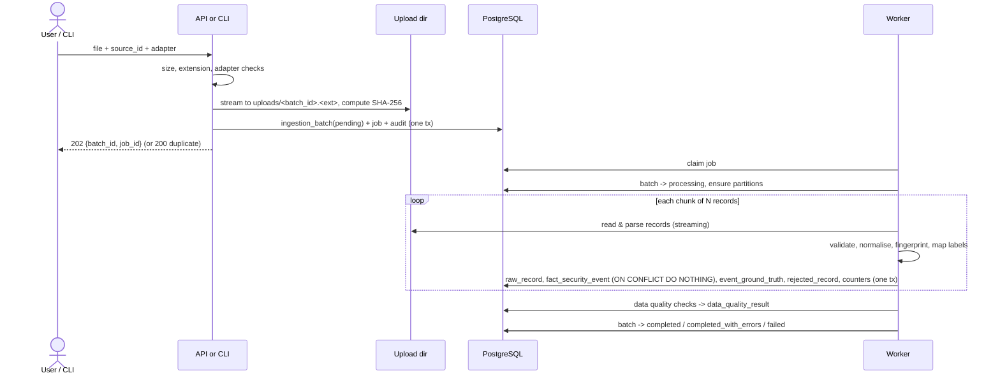

# Data Ingestion

How files become preserved raw records and canonical events. Tables: [DATABASE_DESIGN.md](DATABASE_DESIGN.md#31-raw-ingestion). Fields: [DATA_DICTIONARY.md](DATA_DICTIONARY.md). Security controls: [SECURITY_REQUIREMENTS.md](SECURITY_REQUIREMENTS.md#4-upload-validation-and-safe-parsing).

## 1. Workflow



## 2. Entry points

| Entry point | Use | Limits |
|---|---|---|
| `POST /api/v1/ingestion/uploads` ([API](API_SPECIFICATION.md#56-uploads-and-ingestion)) | Interactive uploads from the dashboard. | `CTI_MAX_UPLOAD_MB` (default **50 MB**). |
| `cti ingest --source <source_key> --adapter <adapter> <path> [--assume-event-date YYYY-MM-DD] [--timezone TZ]` | Large public datasets. Runs the same service code inline (no HTTP). | Path must resolve inside `CTI_IMPORT_ROOT` (default `./data`). No size limit beyond disk; streaming. |

Both create an `ingestion_batch` and produce identical results for the same file.

## 3. Upload limits and safe parsing

- **Allowed extensions:** `.csv`, `.tsv`, `.log`, `.json`, `.jsonl`, `.ndjson`. Compressed files and archives (`.gz`, `.zip`, …) are **not accepted in the MVP** (decompression-bomb risk); decompress manually. Support is future work requiring an ADR.
- **The adapter is chosen explicitly** by the user (or the source's `default_adapter`); content is sniffed only to *reject* obvious mismatches (e.g., JSON adapter on CSV content), never to pick code paths automatically.
- Files are streamed to disk with a server-generated name (`<batch_id>.<ext>`); the original filename is stored as display text only.
- **Encoding:** UTF-8 (BOM stripped). An adapter may declare a fallback encoding list (e.g., `cp1252` for CIC-IDS2017); the encoding actually used is recorded in `ingestion_batch.error_summary.encoding`/batch metadata. Undecodable bytes → `ENCODING_ERROR` rejection, never silent replacement in canonical fields.
- **Per-record limits:** max line/record size 1 MiB (`RECORD_TOO_LARGE`), max 512 fields, JSON nesting depth ≤ 32, CSV field size limit 1 MiB.
- **Parsing:** standard-library `csv`/`json` or pandas with `dtype=str` and chunked reading; values are converted by explicit typed validators. No `eval`, no YAML/pickle, no template rendering, no shell, no URL fetching, no DNS resolution.
- **Rejection threshold:** after the first 10,000 records, if the rejected fraction exceeds `CTI_MAX_REJECT_RATIO` (default `0.2`), the batch fails with `ADAPTER_MISMATCH_SUSPECTED`. Raw records already stored are kept for diagnosis.

## 4. Source adapters

Each adapter is a module in `backend/app/ingestion/adapters/` implementing:

```python
class Adapter(Protocol):
    name: str            # e.g. "zeek_conn"
    version: str         # bump when mapping or fingerprint logic changes
    accepted_extensions: frozenset[str]
    def iter_records(self, stream: BinaryIO) -> Iterator[RawRecord]: ...
    def to_canonical(self, raw: RawRecord, ctx: BatchContext) -> CanonicalEvent | Rejection: ...
    def fingerprint_fields(self) -> tuple[str, ...]: ...
```

| Adapter | Input | `event_type` produced | Labels | Status |
|---|---|---|---|---|
| `canonical_csv` | CSV with canonical column names | any canonical type | optional `label_raw` column | MVP |
| `canonical_json` | JSON array of canonical objects | any | optional | MVP |
| `canonical_jsonl` | one canonical object per line | any | optional | MVP |
| `cicids2017` | CIC-IDS2017 CSV exports | `network_flow` | `Label` column | MVP |
| `unsw_nb15` | UNSW-NB15 CSV (raw files or train/test partitions) | `network_flow` | `attack_cat`, `label` | MVP |
| `zeek_conn` | Zeek `conn.log`, TSV (`#fields` header) or JSON lines | `network_flow` | none | MVP |
| `suricata_eve` | Suricata EVE JSON lines | `ids_alert`, `network_flow`, `dns`, `http`, `other` | none | MVP |
| `auth_jsonl` | Authentication events, documented schema below | `auth` | optional `label_raw` | MVP |
| `endpoint_jsonl` | Endpoint events, documented schema below | `endpoint_process`, `endpoint_file`, `endpoint_network` | optional `label_raw` | MVP |
| `asset_inventory_csv` | Asset list → `dim_asset` (not events) | — | — | MVP |
| TI feeds (`ti_csv`, `stix21_bundle`) | Indicators → `ti_indicator` | — | — | Phase 5, [THREAT_INTELLIGENCE.md](THREAT_INTELLIGENCE.md#5-ingestion-and-normalization) |
| `linux_auth_syslog`, Windows event exports | — | — | — | **Future** |

### 4.1 Public dataset adapters — general rules

**Do not assume identical columns or label conventions across datasets, files, or dataset versions.** Each public-dataset adapter must:

1. Normalise header names (strip whitespace, collapse internal spaces, case-fold) before matching, and keep a mapping of original → normalised names in batch metadata.
2. Detect the file variant from headers and fail with `UNSUPPORTED_VARIANT` if required columns are missing — listing which ones.
3. Handle duplicated header names deterministically (suffix `__2`, log a DQ warning).
4. Treat `Infinity`, `-Infinity`, `NaN`, empty strings, and `-` as missing for numeric attributes (NULL + DQ warning count), never as numbers.
5. Keep all non-canonical columns in `attributes` with normalised keys so dataset-specific feature sets can use them.
6. Map labels through a versioned file in `config/label_mappings/` ([ML_CLASSIFICATION.md](ML_CLASSIFICATION.md#3-label-mapping)); unmapped labels are stored raw with `mapping_status = 'unmapped'` and reported.
7. Never fabricate timestamps or IPs (see time handling below).

### 4.2 `cicids2017`

Reference: Canadian Institute for Cybersecurity, CIC-IDS2017 — <https://www.unb.ca/cic/datasets/ids-2017.html> (the page could not be reached when this document was written; verify before citing).

- Several CSV distributions circulate (with and without `Flow ID`, `Source IP`, `Destination IP`, `Timestamp`). The adapter supports:
  - **Variant `flows_with_ids`**: has source/destination IP and port plus `Timestamp` → full canonical event.
  - **Variant `features_only`**: no IPs/timestamps → requires `--assume-event-date`; events get `time_quality = 'assumed'`, NULL IPs. These events are usable for classification only and are **excluded** from time-window anomaly mining and temporal correlation.
- Commonly reported data issues the adapter must *detect* (not assume): leading spaces in header names, a duplicated header (`Fwd Header Length`), non-finite values in rate columns (`Flow Bytes/s`, `Flow Packets/s`), non-UTF-8 characters in some web-attack label strings, and differing timestamp formats between files.
- `Timestamp` is local capture time without timezone: the source's `default_timezone` must be set explicitly by the user; the adapter refuses to run on this variant if the source timezone was never configured (`TIMEZONE_NOT_CONFIGURED`).
- Canonical mapping: destination port → `dst_port`; `Flow Duration` (microseconds in the CICFlowMeter convention — verify against the file's documentation) → `duration_s`; `Total Fwd Packets` → `packets_out`; `Total Backward Packets` → `packets_in`; `Total Length of Fwd Packets` → `bytes_out`; `Total Length of Bwd Packets` → `bytes_in`; `Protocol` (numeric) → `ip_proto` and `protocol`. All other features → `attributes`.
- Fingerprint fields: `src_ip, src_port, dst_ip, dst_port, ip_proto, event_time, duration_s, packets_out, packets_in, bytes_out, bytes_in, label_raw`, plus `record_number` for `features_only` (duplicate feature rows in that variant are real repeated rows and must **not** be silently collapsed; duplicates are handled at ML split time — [ML_CLASSIFICATION.md](ML_CLASSIFICATION.md#6-leakage-aware-splitting)).

### 4.3 `unsw_nb15`

Reference: UNSW Canberra, UNSW-NB15 — <https://research.unsw.edu.au/projects/unsw-nb15-dataset> (verified). Nine attack categories are documented (Fuzzers, Analysis, Backdoors, DoS, Exploits, Generic, Reconnaissance, Shellcode, Worms); a training partition (175,341 records) and testing partition (82,332 records) are provided alongside four larger CSV files.

- **Variant `raw_records`** (the four large CSVs): may have **no header row**; column names come from the dataset's separate features file. The adapter requires the user to supply/accept a header specification stored in `config/datasets/unsw_nb15_columns.toml` and verifies the column count. Uses `srcip`, `sport`, `dstip`, `dsport`, `proto`, `stime`/`ltime` (epoch seconds), `dur`, `sbytes`, `dbytes`, `spkts`, `dpkts`, `attack_cat`, `label`.
- **Variant `partition`** (training/testing set CSVs): has a header and an `id` column but no IPs or timestamps → `--assume-event-date` required, `time_quality = 'assumed'`, classification-only (as above). The `partition` name (`training`/`testing`) is recorded in batch metadata so the [predefined split](ML_CLASSIFICATION.md#6-leakage-aware-splitting) can reproduce the official partition.
- Label quirks to handle: empty `attack_cat` for normal traffic in some files versus `Normal` in others; inconsistent whitespace/plurals (e.g., `Backdoor` vs `Backdoors`); non-numeric port values. `label` (0/1) is stored in `event_ground_truth.is_attack`; conflicts between `label` and `attack_cat` → `mapping_status = 'ambiguous'`.

### 4.4 `zeek_conn`

Reference: <https://docs.zeek.org/en/master/logs/conn.html> (verified).

- TSV: parse `#separator`, `#set_separator`, `#unset_field` (`-`), `#empty_field` (`(empty)`), `#fields`, `#types` headers; reject files without `#fields`. JSON: one object per line with dotted keys (`id.orig_h`).
- Mapping: `ts` (epoch float) → `event_time`; `uid` → `source_event_id`; `id.orig_h/id.orig_p` → `src_ip/src_port`; `id.resp_h/id.resp_p` → `dst_ip/dst_port`; `proto` → `protocol`; `service` → `app_protocol`; `duration` → `duration_s`; `orig_bytes`/`resp_bytes` (payload bytes) → `bytes_out`/`bytes_in`; `orig_pkts`/`resp_pkts` → `packets_out`/`packets_in`; `conn_state` → `conn_state`; `history`, `missed_bytes`, `orig_ip_bytes`, `resp_ip_bytes` → `attributes`.
- Note: Zeek payload byte counts are **not** semantically identical to CICFlowMeter or UNSW byte counts; models trained on one source are not assumed valid on another.
- Fingerprint: `uid, event_time`.

### 4.5 `suricata_eve`

Reference: <https://docs.suricata.io/en/latest/output/eve/eve-json-format.html> (verified).

- One JSON object per line. Common fields: `timestamp`, `flow_id`, `event_type`, `src_ip`, `src_port`, `dest_ip`, `dest_port`, `proto`, `app_proto`.
- `alert` → `ids_alert`: `alert.signature_id`, `alert.signature`, `alert.category`, `alert.severity` → `signature_id`, `signature`, `alert_category`, `source_severity`.
- `flow` → `network_flow`: `flow.pkts_toserver/pkts_toclient`, `flow.bytes_toserver/bytes_toclient`, `flow.start`, `flow.end`.
- `dns` → `dns`, `http` → `http`: the location of query names differs between Suricata versions; the adapter tries a fixed, documented list of paths (`dns.rrname`, `dns.queries[0].rrname`, `dns.query[0].rrname`) and leaves the field NULL if none is present — it never guesses a value. Verify against your sensor's output.
- Other event types → `other` with the full object in `attributes`.
- `flow_id` groups multiple events of the same flow; it is stored in `source_event_id` but is **not unique per event**. Fingerprint: `flow_id, event_type, timestamp, signature_id` (alerts) or `flow_id, event_type, timestamp`.

### 4.6 `auth_jsonl`

```json
{"timestamp": "2026-03-01T10:15:02Z", "user_name": "alice", "auth_result": "failure",
 "auth_method": "password", "src_ip": "192.0.2.10", "host_name": "srv-01", "service": "sshd"}
```

Required: `timestamp`, `user_name`, `auth_result` (`success`|`failure`). Optional: `auth_method`, `src_ip`, `host_name`, `service`, `label_raw`. Fingerprint: all provided fields. Converting OS-native logs (Linux `auth.log`, Windows Security events) to this format is out of scope for the MVP.

### 4.7 `endpoint_jsonl`

Required: `timestamp`, `host_name`, `event_action` (`process_start` → `endpoint_process`, `file_create`/`file_modify` → `endpoint_file`, `network_connect` → `endpoint_network`). Optional: `user_name`, `process_name`, `process_command_line`, `parent_process_name`, `file_path`, `file_sha256`, `dst_ip`, `dst_port`, `label_raw`. Command lines and paths are stored as inert text ([SECURITY_REQUIREMENTS.md](SECURITY_REQUIREMENTS.md#5-safe-handling-of-untrusted-logs-and-indicators)).

### 4.8 `asset_inventory_csv`

Columns: `asset_id` (required), `hostname`, `ip_address`, `criticality` (`low|medium|high|critical`), `owner`, `environment`. Changes to an existing asset close the current `dim_asset` row (`valid_to`) and insert a new one (SCD Type 2). Events are linked to assets at load time by IP/hostname match against the version valid at `event_time`.

## 5. Validation and normalisation

Order of operations per record:

1. **Structural parse** (adapter) → `RawRecord` with `record_number`, `raw_payload`/`raw_text`, `record_sha256`.
2. **Field mapping** to canonical names.
3. **Type validation** with explicit typed validators in `app/ingestion/normalize.py` (one validator per field kind, so each failure maps to exactly one rejection code; rules in [DATA_DICTIONARY.md](DATA_DICTIONARY.md)).
4. **Normalisation:** timestamps → UTC `timestamptz`; IPs → canonical text form (IPv4-mapped IPv6 → IPv4); protocol names lowercase (`6` → `tcp`, `17` → `udp`, `1` → `icmp`); ports 0–65535; counters ≥ 0; strings trimmed and NUL bytes removed; `user_name` case preserved (a lowercase `user_name_normalized` is derived for matching).
5. **Derived fields:** `date_key`, `event_hour`, `event_fingerprint`.
6. **Label mapping** (labelled datasets only) → ground-truth row.
7. **Required-field failure** → rejection. **Optional-field failure** → field set NULL and a per-field warning counter incremented (reported in data quality), record still loaded.

## 6. Deduplication and idempotency

- **File level:** SHA-256 of file bytes + `source_id` + adapter name/version. A match returns the original batch (`status = duplicate`, HTTP 200 with `duplicate_of`). Re-processing with a newer adapter version is allowed and produces a new batch.
- **Record level:** `event_fingerprint = sha256(adapter_name | adapter_version_major | canonical values of fingerprint_fields())` with deterministic serialisation (UTC ISO-8601 timestamps, canonical IP text, `NULL` as empty marker). Inserted with `ON CONFLICT DO NOTHING` on `(source_id, event_fingerprint, event_time)`.
- Duplicates are counted (`records_duplicate`), not rejected; their raw records are still preserved for lineage.
- Changing fingerprint logic requires bumping the adapter **major** version and a note in the changelog, because it changes dedup behaviour.

## 7. Invalid-record handling

| `error_code` | Meaning |
|---|---|
| `MALFORMED_CSV_ROW` | CSV parse error. |
| `WRONG_FIELD_COUNT` | Row length ≠ header length. |
| `MALFORMED_JSON` | Line is not valid JSON or not an object. |
| `NESTING_TOO_DEEP` | JSON depth > 32. |
| `RECORD_TOO_LARGE` | Record > 1 MiB. |
| `ENCODING_ERROR` | Undecodable bytes. |
| `MISSING_REQUIRED_FIELD` | Required canonical field absent or empty. |
| `INVALID_TIMESTAMP` | Unparseable timestamp. |
| `TIMESTAMP_OUT_OF_RANGE` | Before 2000-01-01 (start of `dim_date`) or more than 24 h in the future. |
| `INVALID_IP` | Required IP field invalid. |
| `INVALID_PORT` | Required port outside 0–65535. |
| `INVALID_NUMBER` | Required numeric field not finite or not a number. |
| `NEGATIVE_COUNTER` | Bytes/packets/duration < 0 in a required field. |
| `UNKNOWN_EVENT_TYPE` | Value not in the canonical `event_type` list (or an unknown endpoint `event_action`). |
| `INVALID_VALUE` | A required enumerated/structured value is invalid (e.g., `is_attack`, UNSW `label`). |
| `UNSUPPORTED_VARIANT` | (batch-level) required columns missing. |
| `TIMEZONE_NOT_CONFIGURED` | (batch-level) naive timestamps without configured source timezone. |
| `ADAPTER_MISMATCH_SUSPECTED` | (batch-level) rejection ratio exceeded. |
| `TIMESTAMP_FORMAT_AMBIGUOUS` | (batch-level) day/month order cannot be determined; pass `--date-order dmy\|mdy`. |
| `MISSING_OPTION` | (batch-level) the variant needs an option, e.g. `--assume-event-date`. |
| `FILE_CHANGED` / `FILE_NOT_FOUND` | (batch-level) the stored file no longer matches its registered SHA-256 / is gone. |
| `FILE_TOO_LARGE` | (batch-level) a JSON-array file exceeds 256 MiB (use JSON lines). |
| `ADAPTER_VERSION_CHANGED` | (batch-level) the installed adapter version differs from the registered one; upload again. |
| `CANCELLED` | (batch-level) the job was cancelled; retry resumes after `last_committed_record`. |

Rejected records keep their `raw_record` row and are visible in `GET /api/v1/ingestion/batches/{batch_id}/rejections` with sanitised details. Error details never echo more than 200 characters of the offending value.

## 8. Batch status and retries

```text
pending ──▶ processing ──▶ completed
                     ├──▶ completed_with_errors   (≥1 rejected record)
                     └──▶ failed                  (fatal error; resumable)
(upload) ──▶ duplicate                            (file already ingested)
```

- Each chunk commits atomically and updates `last_committed_record`.
- Transient failures (DB connection loss, deadlock) → job retried up to 3 attempts with exponential back-off (10 s, 60 s, 300 s), resuming after `last_committed_record`. Because inserts are idempotent, overlap is harmless.
- Deterministic failures (unsupported variant, threshold exceeded) are **not** retried.
- `POST /api/v1/ingestion/batches/{batch_id}/retry` (admin/analyst) re-enqueues a `failed` batch.
- Counters must reconcile: `records_total = records_loaded + records_rejected + records_duplicate`; a data-quality check fails otherwise.

## 9. Provenance

For every event the system can answer: which file (name, SHA-256, size, uploader, upload time), which record number, which adapter/normaliser version, which timezone assumption, which label-mapping version. These are exposed in `GET /api/v1/events/{event_id}` under `provenance`.

## 10. Data-quality checks (per batch)

| Check | Fail/warn condition |
|---|---|
| `counter_reconciliation` | Counters do not reconcile → fail. |
| `rejection_ratio` | > 5 % warn, > 20 % fail. |
| `null_rate:<field>` | Null rate of expected fields above adapter-declared thresholds → warn. |
| `non_finite_values` | Count of non-finite numeric attributes replaced with NULL → warn if > 0. |
| `timestamp_range` | Events outside the declared dataset range or in the future → warn. |
| `time_quality_assumed` | Any `assumed` timestamps → warn (informational). |
| `default_partition_empty` | Rows in default partition → fail. |
| `unmapped_labels` | Any unmapped labels → warn with the distinct values. |
| `duplicate_ratio` | > 50 % duplicates → warn (possible re-import). |

Results are stored in `data_quality_result` and shown on the Data Quality page.

## 11. Reproducible ingestion workflow

1. Download the dataset manually into `data/external/<dataset>/` (git-ignored). Record the download URL, date, and file SHA-256 in `data/external/<dataset>/SOURCE.md` (git-ignored, local).
2. Create the source: `POST /api/v1/sources` or `cti seed-reference` (creates default sources such as `cicids2017`, `unsw-nb15`) and set `default_timezone`.
3. Run `cti ingest --source <source_key> --adapter <adapter> data/external/<dataset>/<file>` for each file.
4. Check batch status and data-quality results (`GET /api/v1/ingestion/batches`, Data Quality page).
5. Record the batch IDs; training configs reference batch IDs, not file paths, so snapshots are reproducible.

For tests and demos, use the committed synthetic fixtures in `data/samples/` generated by `cti generate-synthetic` ([TESTING_STRATEGY.md](TESTING_STRATEGY.md#3-fixtures-and-test-data)).

## 12. Adding a new adapter

1. Write an ADR if it adds a dependency or a new event type.
2. Implement the protocol in `app/ingestion/adapters/<name>.py` with a version.
3. Add a small fixture file (synthetic or a few rows that you are licensed to commit) under `backend/tests/fixtures/ingestion/<name>/` including malformed examples.
4. Add tests: header detection, mapping, rejection codes, fingerprint stability, idempotent re-import.
5. Document it in §4 and any new fields in [DATA_DICTIONARY.md](DATA_DICTIONARY.md).

## 13. Implementation notes (Phase 2)

- **Record numbers** are 1-based ordinals of *data* records (header and blank lines are not counted). `record_sha256` covers the original bytes of the record (all physical lines of a multi-line CSV record); for JSON-array files it covers the canonical JSON of the element.
- **Raw payload keys** for delimited files are the *normalised* header names (duplicates suffixed `__2`); the original → normalised map is stored in `ingestion_batch.metadata.header_map`.
- **NUL bytes and unpaired surrogates** cannot be stored in PostgreSQL text/JSON; they are escaped visibly (`\x00`) in raw records and `raw_record.raw_nul_escaped` is set. Canonical text fields drop NUL bytes.
- **Timestamps:** every database session runs in UTC. Naive timestamps require a timezone (source `default_timezone` or the batch `timezone` option) for *every* adapter; otherwise the batch fails with `TIMEZONE_NOT_CONFIGURED`. The timezone actually used is stored in `timezone_assumption`.
- **CIC-IDS2017 timestamps** (`D/M/YYYY H:MM[:SS] [AM|PM]`): if day and month are both ≤ 12 and differ, `--date-order dmy|mdy` is required; values contradicting the given order are rejected. `Flow Duration` is converted from microseconds (CICFlowMeter convention — verify against your copy).
- **UNSW-NB15 raw files** use the column list in `config/datasets/unsw_nb15_columns.toml`, which was transcribed without access to the files and must be verified; rows with a different field count are rejected (`WRONG_FIELD_COUNT`). Ports written as `0x…` are parsed as hexadecimal; `-` is NULL.
- **`dst_port`** is optional for all event types (dataset files contain non-numeric ports); its null rate is a data-quality check for flow adapters.
- **Asset inventory** import is synchronous (`POST /api/v1/assets/import`, ≤ 10 MB, `cti` command not yet provided). The first version of each asset is assumed valid from 2000-01-01 so historical events link to it; later changes open a new version at import time. Events are linked at load time only (importing assets later does not back-fill older events).
- **Data-quality results** are derived data: re-running the checks replaces a batch's previous results.
