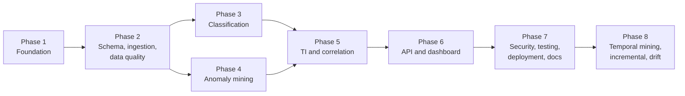

# Implementation Roadmap

Eight phases. **Phases 1–7 are the MVP**; Phase 8 is advanced work. Implement one phase at a time, one milestone at a time, following [CLAUDE.md](CLAUDE.md). Acceptance criteria (AC-x.y) are defined in [ACCEPTANCE_CRITERIA.md](ACCEPTANCE_CRITERIA.md) and are the only definition of done.

## Progress

| Phase | Status | Commit | Notes |
|---|---|---|---|
| 1 | Complete (Docker verification AC-1.2D not run) | `57d353c` | Native setup verified. |
| 2 | Complete except AC-2.8 (no public dataset present) | see `git log` | 9 adapters, DQ, events/analytics API, synthetic generator. |
| 3 | Complete except AC-3.9 (no public dataset present) | see `git log` | RF + baselines, leakage checks, registry, scoring. |
| 4 | Complete; AC-4.4 only partly met (robust z flags the planted anomaly, Isolation Forest does not on the small synthetic sample - documented limitation) | see `git log` | Window features, robust z, Isolation Forest, explanations. |
| 5 | Complete except: AC-5.5 partly met (4 of 5 default rules fire on the synthetic planted scenarios; `anomaly_with_malicious_classification` is covered by unit tests only because the scenario plants no src_ip anomaly with history); TAXII polling (5.6, optional) deferred to Phase 8 | see `git log` | CSV/STIX/manual indicators, exact matching, ATT&CK import + mappings, rule DSL, risk_v1, alerts/cases/feedback, CLI. |
| 6 | Complete; the Audit history page stays a labelled placeholder until its endpoint ships in Phase 7 | see `git log` | `/dashboard/overview`, all §5 pages on real endpoints (Recharts), page state tests, live check against the dev database. |
| 7 | Not started | | |
| 8 | Not started | | |

Phases 3 and 4 both depend only on Phase 2 and could be swapped, but they are done **sequentially** (3 then 4) to keep one phase in flight.

**Cross-cutting rule:** each phase ships its own backend endpoints (with tests) for the features it adds, plus minimal frontend wiring where useful. Phase 6 completes the full dashboard against those endpoints. Authentication/RBAC are built in Phase 1 so no unprotected endpoint ever exists; Phase 7 hardens and verifies security.

---

## Phase 1 — Repository setup and foundation

**Goal:** a running, tested skeleton with auth, jobs, migrations, and an empty-but-honest UI.

| Milestone | Deliverables |
|---|---|
| 1.1 Repository skeleton | Layout from [ARCHITECTURE.md §4](ARCHITECTURE.md#4-repository-layout-target), `.gitignore`, `.env.example`, `backend/pyproject.toml` + `uv.lock`, `frontend/package.json` + lockfile, `.nvmrc`, ruff/mypy/eslint/prettier configs. |
| 1.2 Backend core | App factory, settings (`pydantic-settings`), JSON logging with request IDs and redaction, problem+json error handling, DB session management, `/health`, `/health/ready`. |
| 1.3 Migrations baseline | Alembic setup; ops tables (`app_user`, `auth_session`, `audit_log`, `job`), `dim_date` seed. Migration test harness. |
| 1.4 Auth and RBAC | Password hashing, sessions, CSRF, `require_role`, `/auth/*`, `/users`, `cti create-admin`, audit helper, route-enumeration test. |
| 1.5 Job queue and worker | `job` repository, `enqueue()`, `cti worker` loop with `SKIP LOCKED`, heartbeat, retry policy, `diagnostic` job, `/jobs` endpoints. |
| 1.6 Frontend shell | Vite/React/TS/Tailwind setup, API client (CSRF, problem+json), TanStack Query provider, router with all routes, login, app shell, empty states, test setup with MSW. |
| 1.7 Local runtime | Native setup (PostgreSQL, uv, npm) documented and verified. Optional Docker Compose files (`postgres`, `backend`, `worker`, `frontend` with health checks, volumes, test DB creation) kept for later containerised verification. |

- **Dependencies:** none.
- **Acceptance:** AC-1.1 – AC-1.10.
- **Tests required:** unit (config, redaction, password policy), integration (health, auth, jobs, migrations), authorization enumeration, frontend shell tests.
- **Complete when:** all Phase 1 ACs met with evidence; documentation updated for any deviation.

## Phase 2 — Database schema, ingestion, normalisation, and data quality

**Goal:** preserve and normalise real and synthetic security data idempotently, and query it.

| Milestone | Deliverables |
|---|---|
| 2.1 Warehouse schema | Migrations for raw tables, dimensions, partitioned `fact_security_event`, `event_ground_truth`, `data_quality_result`, `ensure_event_partitions`; `cti seed-reference`. |
| 2.2 Ingestion framework | Adapter protocol, canonical Pydantic model, validators/normalisers, fingerprinting, chunked loader with resume, rejection handling, batch lifecycle, upload endpoint + CLI. |
| 2.3 Canonical and log adapters | `canonical_csv/json/jsonl`, `zeek_conn`, `suricata_eve`, `auth_jsonl`, `endpoint_jsonl`, `asset_inventory_csv`. |
| 2.4 Public dataset adapters | `cicids2017`, `unsw_nb15` with variant detection and label mapping files. |
| 2.5 Data quality | Checks from [DATA_INGESTION.md §10](DATA_INGESTION.md#10-data-quality-checks-per-batch), DQ endpoints. |
| 2.6 Query API | `/events`, `/events/{id}`, `/events/{id}/raw`, `/analytics/*`, `/sources`, `/adapters`, `/assets`, `/ingestion/*`. |
| 2.7 Synthetic data | `cti generate-synthetic` scenarios with `expected.json`; committed small samples in `data/samples/`. |
| 2.8 Real dataset import | Import at least one public dataset file locally (user-provided download); record throughput and DQ results. |

- **Dependencies:** Phase 1.
- **Acceptance:** AC-2.1 – AC-2.11.
- **Tests required:** adapter fixtures (all rejection codes), idempotency, resume, API filters/pagination, migration tests, generator determinism.
- **Complete when:** ACs met; AC-2.8 either met or explicitly reported "not run — dataset not present" (phase then *partially complete* until done).

## Phase 3 — Supervised classification

**Goal:** honest, reproducible attack-category classification with a model registry.

| Milestone | Deliverables |
|---|---|
| 3.1 Registry schema | `ml_training_run`, `ml_model`, `ml_scoring_run`, `classification_result` migrations; artifact storage helpers with integrity checks. |
| 3.2 Features | `flow_v1`, `cicids2017_native_v1`, `unsw_nb15_native_v1` feature-set files and builders; denylist. |
| 3.3 Splits and leakage | `group_stratified`, `temporal`, `predefined`; duplicate/conflict analysis; leakage checks. |
| 3.4 Training and evaluation | Baselines + RF, tuning on validation, evaluation report, training job + API + CLI. |
| 3.5 Promotion and inference | Promotion gate, scoring job, `/classification/*`, `/models/*`. |
| 3.6 Real dataset run | Train on the imported public dataset; report actual metrics with snapshot hash and split. |

- **Dependencies:** Phase 2 (events, ground truth, jobs).
- **Acceptance:** AC-3.1 – AC-3.10.
- **Tests required:** [TESTING_STRATEGY.md §7](TESTING_STRATEGY.md#7-ml-pipeline-tests) classification items.
- **Complete when:** ACs met; metrics reported only from executed runs.

## Phase 4 — Anomaly mining

**Goal:** explainable detection of unusual entity behaviour.

| Milestone | Deliverables |
|---|---|
| 4.1 Window features | `window_v1` builders for host/account/src_ip; baseline queries. |
| 4.2 Methods | Robust z-score and Isolation Forest training/scoring jobs; threshold selection; `anomaly_result`. |
| 4.3 Explanations and history | Top deviations, baseline/history/seasonal comparisons, `/anomalies/*`. |
| 4.4 Evaluation | Proxy evaluation report on labelled data; limitations recorded. |

- **Dependencies:** Phase 2; reuses the Phase 3 registry and artifact code.
- **Acceptance:** AC-4.1 – AC-4.6.
- **Tests required:** [TESTING_STRATEGY.md §7](TESTING_STRATEGY.md#7-ml-pipeline-tests) anomaly items.
- **Complete when:** ACs met.

## Phase 5 — Threat intelligence and correlation

**Goal:** enrich events with optional TI/ATT&CK and correlate evidence into explainable alerts and cases.

| Milestone | Deliverables |
|---|---|
| 5.1 TI storage and import | `ti_*` and `indicator_match` migrations; manual/CSV/STIX import; normalisation; versioning; feed health. |
| 5.2 Matching | Exact matching job, retro-hunt option, `/threat-intel/*`. |
| 5.3 ATT&CK | `attack_technique` import (`cti attack-import`), category mappings with rationale, `/attack/*`. |
| 5.4 Correlation engine | Rule DSL + validation, five default rules, dedup, risk scoring, correlation job, `/correlation/*`. |
| 5.5 Investigation workflow | Alerts, cases, timeline, notes, feedback endpoints with audit. |
| 5.6 (Optional) TAXII | `taxii` extra; polling job against local stub. May be deferred to Phase 8. |

- **Dependencies:** Phases 2–4 (correlation consumes classification and anomaly outputs).
- **Acceptance:** AC-5.1 – AC-5.8.
- **Tests required:** [TESTING_STRATEGY.md §9](TESTING_STRATEGY.md#9-indicator-matching-and-correlation-tests).
- **Complete when:** ACs met with zero feeds configured.

## Phase 6 — API and dashboard integration

**Goal:** the complete investigation dashboard on real API data.

| Milestone | Deliverables |
|---|---|
| 6.1 Overview | `/dashboard/overview` endpoint; overview page. |
| 6.2 Data pages | Ingestion, event explorer, data quality pages. |
| 6.3 ML pages | Classification analytics, anomaly explorer, model registry. |
| 6.4 Investigation pages | Threat intelligence, alerts, cases. |
| 6.5 Admin pages | Settings and audit history. |

- **Dependencies:** Phases 1–5.
- **Acceptance:** AC-6.1 – AC-6.7.
- **Tests required:** [TESTING_STRATEGY.md §13](TESTING_STRATEGY.md#13-frontend-tests), E2E dashboard consistency check.
- **Complete when:** ACs met.

## Phase 7 — Security, testing, deployment, and documentation

**Goal:** a verified, documented, small-but-complete MVP release.

| Milestone | Deliverables |
|---|---|
| 7.1 Hardening | Rate limiting, headers, CORS, production profile, non-root containers, DB role separation. |
| 7.2 Test completion | Full authorization/security suites, API-level E2E on synthetic scenario. |
| 7.3 Dependency and retention | Audits, retention command. |
| 7.4 Performance measurement | Measure NFR-03/NFR-04; add indexes only where measured. |
| 7.5 Documentation reconciliation | Update all specs to match implementation; ADRs; link check; fresh-clone walkthrough of the deployment guide. |

- **Dependencies:** Phases 1–6.
- **Acceptance:** AC-7.1 – AC-7.9 and the MVP release checklist.
- **Complete when:** all MVP checklist items met with evidence.

## Phase 8 — Advanced temporal pattern mining, incremental ingestion, concept drift (future)

| Milestone | Deliverables |
|---|---|
| 8.1 Incremental processing | `processing_watermark`, incremental scoring/matching/correlation, `cti watch` inbox ingestion, optional scheduling. |
| 8.2 Concept drift | PSI/feature drift, flagged-rate and prediction drift reports, Models page warnings ([ANOMALY_DETECTION.md §11](ANOMALY_DETECTION.md#11-concept-drift-monitoring-phase-8)). |
| 8.3 Temporal pattern mining | Sequence building, frequent sequential pattern mining, candidate rules ([ATTACK_CORRELATION.md §10](ATTACK_CORRELATION.md#10-future-temporal-pattern-mining-phase-8)). |
| 8.4 TAXII (if deferred) | Polling with cursors, retries, rate-limit handling. |

- **Dependencies:** MVP complete. Each milestone requires an ADR if it adds dependencies (e.g., Celery/Redis for scheduling).
- **Acceptance:** AC-8.1 – AC-8.4.

---

## Keeping the first release small

- Exactly the adapters, models, rules, and pages listed above — no extra algorithms, data stores, or services.
- If time is short, cut **depth, not honesty**: e.g., fewer tuning grid points, fewer default rules — never placeholder pages or fabricated outputs. Any cut is recorded as a scope change in this file and in [ACCEPTANCE_CRITERIA.md](ACCEPTANCE_CRITERIA.md).
