# Supervised Attack Classification

Specification of the pipeline that assigns a canonical attack category ([taxonomy](DATA_DICTIONARY.md#112-attack_category)) to security events. Storage: [DATABASE_DESIGN.md](DATABASE_DESIGN.md#35-ml-registry-and-model-outputs). Code location: `backend/app/ml/classification/`, `backend/app/ml/features/`.

## 1. Scope and honest claims

- The classifier recognises **only the categories present in its training data** (`ml_model.class_labels`). Novel attacks are typically predicted as the nearest known category or `BENIGN`; anomaly mining ([ANOMALY_DETECTION.md](ANOMALY_DETECTION.md)) is the complementary mechanism.
- Results on public lab datasets (CIC-IDS2017, UNSW-NB15) do **not** imply comparable performance on another network. Cross-source use is reported as such and never claimed to generalise.
- Metrics are always reported per class and with the dataset, split strategy, and snapshot named. No "perfect detection" claims; near-perfect scores trigger a leakage investigation (§6.4), not a celebration.
- `predicted_score` is an uncalibrated vote fraction, not a probability of attack.

## 2. Pipeline

```mermaid
flowchart LR
    A[Snapshot selection<br/>batch IDs + filters] --> B[Load events + ground truth]
    B --> C[Label mapping check<br/>drop unmapped/ambiguous]
    C --> D[Feature building<br/>feature set vX]
    D --> E[Cleaning<br/>non-finite to NaN, dedup analysis]
    E --> F[Leakage-aware split<br/>train / validation / test]
    F --> G[Fit sklearn Pipeline on train<br/>impute, scale, encode, model]
    G --> H[Tune on validation]
    H --> I[Final evaluation on test<br/>once]
    I --> J[Persist artifact + manifest<br/>register candidate model]
    J --> K[Admin promotion<br/>candidate to active]
    K --> L[Scoring job<br/>classification_result]
```



Training and scoring always run as background jobs (`POST /api/v1/classification/training-runs`, `cti train classifier`), never in a request handler.

## 3. Label mapping

- Each labelled dataset has a versioned mapping file `config/label_mappings/<dataset>.toml` with `version`, `normalisation` rule, and `[map]` entries from normalised raw label → canonical code.
- **Label normalisation for lookup:** Unicode NFKC → lowercase → replace any run of non-alphanumeric characters with one space → trim. (This makes `Web Attack – XSS` and garbled-dash variants map identically.) `label_raw` is stored unmodified apart from whitespace trim.
- Unmapped labels: `mapping_status = 'unmapped'`, excluded from training, listed in the training report and data-quality results. Never guessed.
- Mapping changes bump the mapping version; existing ground-truth rows keep their version; re-mapping happens by re-ingestion or a documented backfill command, never silently.

Initial mappings (to be confirmed against the actual files during Phase 2; unexpected labels must surface as `unmapped`):

| Dataset | Raw label(s) (normalised) | Canonical |
|---|---|---|
| CIC-IDS2017 | `benign` | `BENIGN` |
| | `dos hulk`, `dos goldeneye`, `dos slowloris`, `dos slowhttptest` | `DOS` |
| | `ddos` | `DDOS` |
| | `portscan` | `RECONNAISSANCE` |
| | `ftp patator`, `ssh patator` | `BRUTE_FORCE` |
| | `web attack brute force`, `web attack xss`, `web attack sql injection` | `WEB_ATTACK` |
| | `bot` | `BOTNET` |
| | `infiltration` | `INFILTRATION` |
| | `heartbleed` | `EXPLOIT` |
| UNSW-NB15 | `normal`, empty with `label = 0` | `BENIGN` |
| | `fuzzers` | `FUZZING` |
| | `analysis` | `ANALYSIS` |
| | `backdoor`, `backdoors` | `BACKDOOR` |
| | `dos` | `DOS` |
| | `exploits` | `EXPLOIT` |
| | `generic` | `GENERIC` |
| | `reconnaissance` | `RECONNAISSANCE` |
| | `shellcode` | `SHELLCODE` |
| | `worms` | `WORM` |

Mapping heterogeneous datasets onto one taxonomy loses detail (e.g., four DoS tools → `DOS`). Fine-grained labels remain in `label_raw` and can be used by a dataset-specific configuration (`label_level = "raw"`).

## 4. Feature selection

Feature sets are versioned TOML files in `config/feature_sets/` with an **explicit allowlist**, and are implemented in `app/ml/features/`.

| Feature set | Applies to | Contents |
|---|---|---|
| `flow_v1` | Any `network_flow` source | `duration_s`, `bytes_out`, `bytes_in`, `packets_out`, `packets_in`; derived `total_bytes`, `total_packets`, `bytes_per_packet_out`, `bytes_per_packet_in`, `out_in_byte_ratio` (+1 smoothing), `packets_per_second`, `bytes_per_second` (duration floored at 1 ms); categorical `protocol` (`tcp`/`udp`/`icmp`/`other`), `dst_port_class` (`well_known` < 1024, `registered` 1024–49151, `dynamic` ≥ 49152, `none`). |
| `cicids2017_native_v1` | `cicids2017` source | `flow_v1` + allowlisted numeric CICFlowMeter attributes (listed in the TOML file). |
| `unsw_nb15_native_v1` | `unsw_nb15` source | `flow_v1` + allowlisted UNSW-NB15 attributes; categorical `proto`, `service`, `state`. |

**Always excluded** (enforced by a denylist check that fails training): `event_id`, `raw_record_id`, `record_number`, `batch_id`, `source_id`, `source_event_id`, `event_fingerprint`, `src_ip`, `dst_ip`, `src_port`, `event_time`, `event_end_time`, `date_key`, `event_hour`, `ingested_at`, any ground-truth field (`label_raw`, `is_attack`, `attack_category`, and attributes named like `label`, `attack_cat`, `id`, `flow_id`, `timestamp`).

**Raw `dst_port`** is excluded by default because attacks in lab datasets often concentrate on specific ports, which lets a model learn the lab setup rather than behaviour. It may be enabled explicitly (`include_raw_dst_port = true`); the report then shows results with and without it.

Feature importance is reported with **permutation importance on the validation set** (top 20); impurity-based importance may be shown only as secondary information because it is biased toward high-cardinality features.

## 5. Preprocessing

All preprocessing lives inside one scikit-learn `Pipeline` fitted on **training data only**:

1. Non-finite values (`inf`, `-inf`) → `NaN` (done before splitting; deterministic, no fitting).
2. `ColumnTransformer`:
   - numeric: `SimpleImputer(strategy="median", add_indicator=True)` → `FunctionTransformer(np.log1p)` on non-negative heavy-tailed counters → `StandardScaler` (scaling only matters for Logistic Regression; harmless for RF).
   - categorical: `SimpleImputer(strategy="constant", fill_value="missing")` → `OneHotEncoder(handle_unknown="ignore", min_frequency=…)`.
3. Estimator.

Rows with more than 50 % of features missing are excluded and counted in the report.

## 6. Leakage-aware splitting

### 6.1 Split strategies

| `split_strategy` | Description | Use |
|---|---|---|
| `group_stratified` (default) | `StratifiedGroupKFold` with `random_state = seed`: one fold as test (≈20 %), then one fold of the remainder as validation (≈20 % of remaining). Groups keep related records together. | General. |
| `temporal` | Sort by `event_time`; earliest 70 % train, next 15 % validation, last 15 % test (configurable). Reports classes missing from any split. Not allowed when `time_quality = 'assumed'`. | Realistic "train on past, test on future" check. In CIC-IDS2017 different attacks occur on different days, so some classes may be absent from test — report, don't hide. |
| `predefined` | Uses the dataset's official partitions (e.g., UNSW-NB15 training/testing batches) as train/test; validation carved from train with `group_stratified`. | Comparability with published work. |

### 6.2 Group definition

`group_key` options:

- `feature_hash` (default): SHA-256 of the cleaned feature vector (values rounded to 6 significant digits). Exact and rounding-level duplicates share a group, so they cannot appear in both train and test.
- `conversation`: hash of `(src_ip, dst_ip, dst_port, protocol, floor(event_time / 60 s))` merged with `feature_hash` via union-find. Keeps bursts of closely related flows from the same conversation together. Only available when IPs and exact time exist.

### 6.3 Duplicates and label conflicts

- Report: number of duplicate feature vectors, duplicate groups per class, and **label conflicts** (identical feature vectors with different labels).
- Default: conflicting groups are excluded from training and evaluation (count reported). Within-train duplicates are kept by default (`dedupe_train = false`); the option is recorded.
- For `predefined` splits, the overlap between official train and test partitions (identical feature vectors) is computed and reported; `drop_test_overlap = true` evaluates on the non-overlapping test subset as an additional report.

### 6.4 Automated leakage checks (training fails or warns)

| Check | Action |
|---|---|
| Denylisted feature present | **Fail.** |
| Same `event_id` or group in more than one split | **Fail.** |
| Preprocessing fitted outside the pipeline (code check via tests) | **Fail** (tested). |
| Any single feature alone (depth-3 decision tree, validation set) reaches macro-F1 ≥ 0.98 | **Warn** "possible shortcut/leakage feature: X"; shown prominently in the report and blocks promotion until an admin acknowledges it with a note. |
| Test macro-F1 ≥ 0.995 | **Warn** "suspiciously high; review leakage report". |

## 7. Class imbalance

- `class_weight="balanced_subsample"` (RF) and `"balanced"` (Logistic Regression).
- `min_class_support_train` (default 50): malicious classes below this are merged into `OTHER_MALICIOUS` or excluded (`rare_class_policy = "merge" | "exclude"`), always reported.
- Optional majority down-sampling on the **training split only**: `max_majority_ratio` (e.g., BENIGN ≤ 10× the largest attack class), seeded. Validation and test keep natural distribution.
- Synthetic oversampling (SMOTE etc.) is **not** in the MVP (would need `imbalanced-learn` via ADR).

## 8. Models

| Model | Purpose | Defaults |
|---|---|---|
| `DummyClassifier(strategy="most_frequent")` | Floor. | — |
| `DummyClassifier(strategy="stratified")` | Chance-level reference for macro-F1. | `random_state=seed` |
| `LogisticRegression` | Linear baseline. | `class_weight="balanced"`, `max_iter=2000`, `random_state=seed` |
| `RandomForestClassifier` | **Primary model.** | `n_estimators=300`, `min_samples_leaf=1`, `max_features="sqrt"`, `class_weight="balanced_subsample"`, `n_jobs=-1`, `random_state=seed` |

Hyperparameter tuning uses the **validation split only** with a small, configured grid (default: `n_estimators ∈ {100, 300}`, `max_depth ∈ {None, 20}`, `min_samples_leaf ∈ {1, 5}`) and a time budget. The test split is evaluated **once** with the selected configuration. Future models (e.g., `HistGradientBoostingClassifier`) require only config changes; external boosting libraries require an ADR.

## 9. Evaluation

Every training run stores, for every model (baselines included), on validation and test:

- **Per-class** precision, recall, F1, support.
- **Macro-F1** (primary selection metric) and **weighted-F1**.
- **Confusion matrix** — counts and row-normalised — with class order recorded.
- Balanced accuracy; accuracy only alongside the above.
- Binary view (all malicious vs. `BENIGN`): detection rate (malicious recall) and false-positive rate on `BENIGN`.
- 95 % bootstrap confidence interval for macro-F1 on test (1,000 resamples, seeded).
- Permutation importance (validation, top 20).
- Data report: snapshot size, class counts per split, excluded rows by reason, duplicate/conflict statistics, leakage-check results, unmapped labels.

Promotion gate (checked by `POST /api/v1/models/{model_id}/promote`):

1. Training run `succeeded` and leakage checks have no unacknowledged warnings and no failures.
2. Test macro-F1 of the candidate > test macro-F1 of `DummyClassifier(stratified)`.
3. Runtime library versions compatible with the artifact manifest (§10).
4. If an active model exists, the comparison report (§12) exists. Promotion is a human decision; nothing is promoted automatically.

## 10. Model persistence and versioning

```text
artifacts/models/<model_name>/<version>/
  model.joblib      fitted Pipeline (preprocessing + estimator)
  manifest.json     metadata below
  report.json       evaluation report (same content as ml_training_run.metrics)
```

`manifest.json`: `model_id`, `name`, `version`, `task`, `algorithm`, `feature_set` + version + ordered feature list, `class_labels` (ordered), `label_mapping_version`, `training_run_id`, `random_seed`, `artifact_sha256`, Python/scikit-learn/NumPy/pandas versions, git commit, created_at.

- Version = next integer per `name`, assigned in the same transaction that registers the model.
- Artifacts are **write-once**; never overwritten.
- Loading verifies: path is inside `CTI_ARTIFACT_DIR` (no traversal), file SHA-256 equals `ml_model.artifact_sha256`, scikit-learn major.minor equals manifest; otherwise loading fails with a clear error (`ARTIFACT_INTEGRITY_FAILED` / `ARTIFACT_VERSION_MISMATCH`). joblib uses pickle and can execute code on load — never load artifacts from uploads or unknown origins ([SECURITY_REQUIREMENTS.md](SECURITY_REQUIREMENTS.md#9-ml-artifact-safety)).
- Status lifecycle: `candidate → active → archived`; `candidate → rejected`.

## 11. Inference

- `POST /api/v1/classification/scoring-runs` with scope (`batch_ids` or time range + source) → job → loads the **active** model (or an explicit `model_id` for evaluation-only runs, marked as such), builds the same feature set version, predicts in chunks (default 50,000 rows), writes `classification_result` with `ON CONFLICT DO NOTHING`.
- Events whose source/feature set is incompatible with the model (e.g., auth events, missing required native attributes) are skipped and counted by reason — never scored with fabricated defaults.
- New ingestion batches are **not** scored automatically in the MVP; Phase 8 adds watermark-based incremental scoring.

## 12. Retraining

- Triggered manually (API/CLI). Typical reasons: new labelled data, mapping change, feature-set change, drift signal (Phase 8).
- Produces a new `candidate` version. A **comparison report** re-evaluates the current active model on the candidate's test split (when the feature set and label space are compatible) so the comparison uses identical data.
- Analyst feedback (`corrected_category`) can be included only with `include_feedback_labels = true`; such rows are tagged as a separate label source in the snapshot and reported separately. Feedback never overwrites ground truth.

## 13. Reproducibility

A training run is reproducible from its `ml_training_run` row:

- `dataset_snapshot`: batch IDs, filters, row count per class, and `snapshot_hash` = SHA-256 of the sorted `(event_id, event_time, label)` list.
- Full resolved config (TOML content), `random_seed` (used by splitter, sampler, models, bootstrap), feature-set and mapping versions, library versions, git commit.
- Requirement: re-running with the same snapshot, config, seed, and environment produces identical metrics and identical predictions on the test split (verified by a test on synthetic data — [TESTING_STRATEGY.md](TESTING_STRATEGY.md#7-ml-pipeline-tests)).

## 14. Configuration example

`config/ml/classifier_default.toml`:

```toml
name = "attack_classifier"
random_seed = 42
feature_set = "flow_v1"
label_level = "canonical"           # or "raw"
split_strategy = "group_stratified" # "temporal" | "predefined"
group_key = "feature_hash"          # or "conversation"
test_fraction = 0.2
validation_fraction = 0.2
include_raw_dst_port = false
min_class_support_train = 50
rare_class_policy = "merge"
max_majority_ratio = 10.0           # set to 0 to disable down-sampling
include_feedback_labels = false

[snapshot]
batch_ids = []                      # required; filled per run
event_types = ["network_flow"]

[models.random_forest]
n_estimators = [100, 300]
max_depth = [0, 20]                 # 0 means None
min_samples_leaf = [1, 5]

[budget]
max_minutes = 30
```

## 15. Known limitations

- Lab datasets contain artefacts of their generation process; high in-dataset scores can reflect those artefacts.
- Flow-level features cannot see payloads; some web attacks are hard to separate from benign HTTP flows.
- Rare classes (very few samples) produce unstable per-class metrics; confidence intervals and support are always shown.
- Category taxonomies differ across datasets; merged categories hide sub-type confusion.

## 16. Implementation notes (Phase 3)

- Code: `app/ml/features.py` (feature sets, denylist), `app/ml/classification/training.py` (pure training/evaluation), `app/ml/artifacts.py` (persistence and integrity), `app/services/classification.py` and `app/services/models.py` (runs, scoring, registry, promotion gate).
- The selected Random Forest is fitted on the **training split only** (not train + validation), so validation and test reports describe exactly the persisted model.
- A split that cannot keep feature-vector groups apart (fewer distinct groups than folds) fails the run with an explanatory `TrainingError` instead of producing a leaky split.
- Label conflicts (identical feature vectors with different labels) are excluded before splitting, so data with only conflicting rows fails with "need at least two distinct classes".
- The report records class counts before and after the rare-class policy (`split.after_rare_class_policy`).
- `label_level = "raw"` models can be trained and evaluated, but only canonical-category predictions are stored as `classification_result` rows; raw-label predictions are skipped at scoring time.
- `include_feedback_labels = true` is rejected until analyst feedback exists (Phase 5).
- Scoring skips events whose type is not in the feature set (`incompatible_event_type`) or with more than 50 % missing features; both counts are stored on the scoring run.
- The comparison with the active model is computed automatically during training when the feature sets match; otherwise the report states why it was skipped.
- CLI training/scoring run inline (`cti train classifier`, `cti score classifier`); the API enqueues jobs for the worker.
- Measured example (synthetic data, seed 42, 6–10 days, not a benchmark): see the Phase 3 commit message; results on public datasets have not been produced because no dataset is present (AC-3.9 not run).
