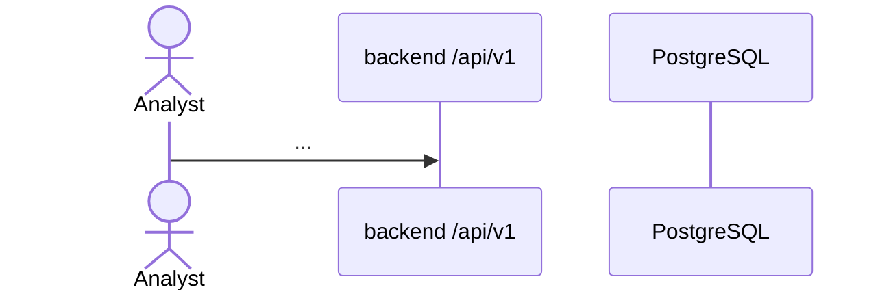

# Diagrams

Where CTI Warehouse diagrams live and how to keep them accurate.

## Principles

- **Diagrams as code.** Use [Mermaid](https://mermaid.js.org/) in Markdown so diagrams are reviewed in diffs and render on GitHub. Binary images (PNG/SVG) are allowed only when Mermaid cannot express the content, and must be exported from a committed source file next to them.
- **One source of truth.** The canonical diagrams stay in the specification they describe; this folder holds *additional* detail diagrams. Don't copy a diagram into two places — link to it.
- **Accurate over pretty.** A diagram that disagrees with the code or specs is a bug. Update diagrams in the same change as the behaviour they depict.
- Label components with the names used in code and specs (`fact_security_event`, `cti worker`, `/api/v1/...`). Mark optional/future elements with "(optional)" or "(future)" and dashed edges.

## Canonical diagrams (in the specs)

| Diagram | Location |
|---|---|
| End-to-end pipeline | [ARCHITECTURE.md §1](../../ARCHITECTURE.md#1-end-to-end-pipeline) |
| Deployment topology (MVP) | [ARCHITECTURE.md §2](../../ARCHITECTURE.md#2-deployment-topology-mvp) |
| Warehouse ER diagram | [DATABASE_DESIGN.md §4](../../DATABASE_DESIGN.md#4-entity-relationship-diagram) |
| Ingestion sequence | [DATA_INGESTION.md §1](../../DATA_INGESTION.md#1-workflow) |
| Classification pipeline | [ML_CLASSIFICATION.md §2](../../ML_CLASSIFICATION.md#2-pipeline) |
| Alert state machine | [ATTACK_CORRELATION.md §8](../../ATTACK_CORRELATION.md#8-analyst-review-workflow) |
| Phase dependencies | [IMPLEMENTATION_ROADMAP.md](../../IMPLEMENTATION_ROADMAP.md) |

## What belongs in this folder

| Kind | File naming | Examples |
|---|---|---|
| Architecture detail | `architecture-<topic>.md` | Module dependency graph, job queue internals. |
| Sequence diagrams | `sequence-<flow>.md` | Login + CSRF flow, model promotion, feed sync with retries, alert dedup. |
| Deployment | `deployment-<profile>.md` | A future production profile (only after its ADR is accepted). |
| Data flow | `dataflow-<topic>.md` | Lineage from raw record to alert evidence; feature-window construction. |

Each file starts with: purpose, the spec section it supports, status (`current` / `proposed` / `future`), and last-verified date.

## Template

````markdown
# Sequence: <flow name>

Supports: [<SPEC>.md §<n>](../../<SPEC>.md#...) · Status: current · Last verified: YYYY-MM-DD



Notes: assumptions, error paths not shown, open questions.
````

## Review checklist

- [ ] Names match code and specs.
- [ ] Optional/future elements are labelled.
- [ ] Linked from the spec it supports.
- [ ] Renders in GitHub's Mermaid preview without errors.
